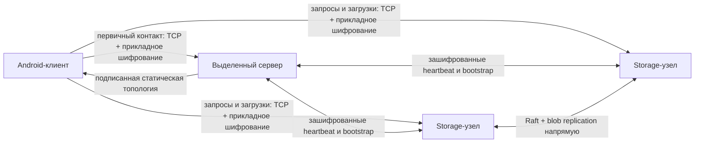

# HomeCloud v1 — общий дизайн системы

## Управление документом

| Атрибут | Значение |
|---|---|
| Тип документа | Общий архитектурный документ и реестр межобластных требований |
| Версия документа | 1.0-draft |
| Статус | Проект требований; базовая версия v1 ещё не утверждена целиком |
| Владелец продукта | Заказчик проекта |
| Область продукта | Общая архитектура; межобластные требования; ссылки на четыре спецификации областей |
| Язык требований | Русский; термины протокола и кода приводятся в оригинальном написании |

### Статусы и атрибуты требований

Каждое требование имеет постоянный ID, ревизию, приоритет, статус, область ответственности, источник и критерий проверки. Ревизия `1` относится к первичной записи требования в этом SRS; изменения отслеживаются системой контроля версий.

| Значение | Определение |
|---|---|
| `Утверждено` | Решение прямо принято заказчиком или следует из явно заданной границы v1 |
| `Предложено` | Требование сформулировано из обсуждённого решения, но конкретное предложение ещё не подтверждено заказчиком |
| `MUST` | Обязательное требование для v1 после утверждения |
| `Тест` | Проверка исполняемым модульным, интеграционным или системным тестом |
| `Инспекция` | Проверка конфигурации, исходного кода, документации или артефакта без исполнения |
| `Анализ` | Проверка свойства расчётом, трассировкой или анализом поведения |
| `Демонстрация` | Проверка наблюдаемым сценарием работы продукта |

`D` в источнике означает решения из диалога с заказчиком; `I` — исходную идею в `PicBackup.md`. PDF-материалы задают методику оформления SRS, но не требования к поведению HomeCloud. Все требования v1 имеют ID, ревизию, статус, владельца и метод проверки. Каждое требование хранится в одном месте: в общем дизайне для межобластных требований либо в спецификации единственной ответственной области.

## 1. Введение

### 1.1 Назначение

Этот документ фиксирует общий архитектурный дизайн и требования, затрагивающие более одной области. Детальные требования распределены между четырьмя спецификациями: `specification-v1/android.md`, `dedicated-server.md`, `storage-cluster.md` и `test-environment.md`. При конфликте применяются ID требований и история их ревизий; пояснительный дизайн сам по себе не вводит дополнительную функциональность.

### 1.2 Образ продукта

HomeCloud v1 автоматически копирует фотографии и видео с Android-устройства в доверенный распределённый серверный кластер. Пользователь задаёт логин и пароль; клиент сравнивает локальную медиатеку с каталогом сервера и передаёт только отсутствующие или изменившиеся версии. Сервер хранит принятые файлы открытыми и распакованными.

### 1.3 Объём первоначальной версии

V1 включает только автоматическую одностороннюю загрузку фото и видео с Android. В v1 нет просмотра, скачивания, восстановления, синхронизации удалений, произвольных файлов, динамического изменения состава кластера и режима одного сервера без Raft.

### 1.4 Предполагаемая аудитория

- заказчик и владелец продукта;
- архитектор системы;
- Android-разработчик;
- разработчики выделенного сервера и storage-узлов;
- разработчик тестовой среды;
- участники ревью и приёмки.

### 1.5 Источники

| ID | Источник | Использование |
|---|---|---|
| `I` | `PicBackup.md` — исходная идея проекта | Исходный замысел и ограничения |
| `D` | Решения заказчика в текущем диалоге | Границы v1, архитектура и протокол |
| `A1` | [Android Developers: partial photo and video access](https://developer.android.com/about/versions/14/changes/partial-photo-video-access) | Runtime-разрешения Android для чтения пользовательских изображений и видео |
| `A2` | [Android Developers: foreground service types](https://developer.android.com/develop/background-work/services/fgs/service-types) | Декларации и разрешения foreground service типа `dataSync` |
| `A3` | [Android Developers: notification runtime permission](https://developer.android.com/develop/ui/views/notifications/notification-permission) | Поведение `POST_NOTIFICATIONS` и уведомлений приложения |
| `SRS-SLIDES` | `03-lifecycle-and-requirements-slides.pdf` | Структура SRS, атрибуты и характеристики хороших требований |
| `SRS-TEXT` | `03-lifecycle-and-requirements-text-1.pdf` | Подробные правила полноты, единичности, атомарности, непротиворечивости, выполнимости и проверяемости |

### 1.6 Соглашения о качестве требований

Перед включением в базовую версию каждое требование должно иметь уникальный ID и одно значение; быть завершённым в пределах собственной формулировки; не противоречить другим требованиям; быть выполнимым в рамках v1; иметь единственную интерпретацию и объективный критерий проверки. Составные требования разделяются. Формулировки вроде «удобно», «быстро», «надёжно» без критерия проверки не используются. Статус `Предложено` запрещает считать требование утверждённой частью базовой версии.

## 2. Общее описание

### 2.1 Контекст продукта и внешние сущности

Система состоит из Android-приложения, одного выделенного сервера и фиксированного набора storage-узлов. Клиент устанавливает начальный защищённый контакт с выделенным сервером, получает статическую топологию и затем напрямую общается с storage-узлами. Storage-узлы непосредственно обмениваются данными Raft и blob-файлами. Выделенный сервер не передаёт и не проксирует файлы.

Внешние сущности: пользователь Android-приложения; оператор, вручную развёртывающий серверный кластер; Android MediaStore; ОС/файловая система узлов; Docker и Rust test harness тестовой среды.

### 2.2 Классы пользователей и ролей

| Роль | Цель и характеристики |
|---|---|
| Пользователь Android-клиента | Регистрирует логин, выдаёт приложению доступ к фото и видео и ожидает автоматической резервной копии |
| Оператор кластера | Настраивает подсеть, манифест и конфигурацию; в v1 вручную устанавливает один и тот же манифест на серверы |
| Разработчик/тестировщик | Запускает компоненты изолированно и проверяет отказоустойчивые сценарии в Docker |

### 2.3 Среда функционирования

- Клиент работает на Android; язык и UI-набор предполагаются Kotlin и Jetpack Compose.
- Серверные компоненты и тестовый harness предполагаются написанными на Rust.
- Сеть может быть недоступна, разделена или иметь задержки; клиент сохраняет незавершённую работу в очереди.
- Узлы работают как отдельные машины/контейнеры и связываются друг с другом напрямую.

### 2.3.1 Сетевая модель развёртывания

Кластер и Android-клиенты развёртываются внутри одной управляемой IP-подсети. Подсеть может быть домашней локальной сетью, например `10.0.0.0/8`, либо VPN-подсетью. Для протокола и архитектуры v1 эти варианты равнозначны при условии прямой IP-доступности назначенных узлов. Указанный диапазон — пример, не фиксированное требование к адресации.

### 2.4 Ограничения и допущения

- При первом подключении клиент доверяет открытому ключу выделенного сервера по TOFU. Независимая проверка первого ключа отсутствует; активная подмена при первом подключении не предотвращается.
- Сервер является доверенной стороной и хранит файлы в открытом и распакованном виде.
- В v1 состав storage-кластера статический. Изменение состава требует ручного обновления развёртывания и манифеста.
- Численные эксплуатационные пределы задаются конфигурацией. Совместимые значения параметров кластера должны быть согласованы между узлами.
- Внешняя синхронизация часов хоста выделенного сервера является ответственностью окружения.

### 2.5 Основные функции продукта

1. Регистрация учётной записи и Android-установки.
2. Обнаружение локальных фото и видео, построение версий и очереди загрузки.
3. Получение актуального каталога подтверждённых версий.
4. Сжатие, шифрование и прямая передача файла storage-узлу.
5. Кворумная запись blob и commit метаданных в Raft.
6. Межузловое восстановление журнала и blob-данных после возврата узла.
7. Изолированное тестирование компонентов и сценариев отказа.

### 2.6 Основной сценарий использования UC-01 «Автоматически сохранить фото и видео»

**Начальное условие:** приложение установлено; пользователь зарегистрирован; приложение имеет необходимые разрешения; выделенный сервер и кластер настроены.

**Основной поток:** приложение получает топологию у выделенного сервера; сканирует доступные медиа; получает полный актуальный каталог сервера; сравнивает хэш, имя и время; сжимает новую версию; присваивает ей стабильный `upload_id`; передаёт её storage-узлу; узел реплицирует blob на кворум и фиксирует метаданные; приложение удаляет элемент из очереди после успешного подтверждения.

**Альтернативные потоки:** при недоступной сети работа остаётся в очереди; при недоступном кворуме клиент повторяет попытки; при незавершённой загрузке сервер отбрасывает частичный объект, а клиент начинает передачу с начала с тем же `upload_id`; если серверная версия уже committed, сервер возвращает сохранённый результат.

## 3. Общий архитектурный дизайн

### 3.1 Компоненты и границы ответственности

| Компонент | Ответственность в v1 | Граница ответственности |
|---|---|---|
| Android-клиент | Регистрация установки, сканирование фото/видео, сравнение каталога, шифрование и отправка | Не предоставляет просмотр, скачивание, восстановление или удаление серверных версий |
| Выделенный сервер | Регистрация аккаунтов/установок, распространение регистрационных данных, выдача топологии, heartbeat | Не хранит и не проксирует файлы; не участвует в Raft |
| Storage-узлы | Проверка запросов, каталог, blob-запись/репликация, Raft и catch-up | В v1 не изменяют membership динамически |
| Тестовая среда | Изолированный запуск компонентов, mocks/fakes и fault injection | Проверяет заданные сценарии; не определяет production-поведение |

### 3.2 Архитектурные инварианты

Этот список резюмирует нормативные требования и не вводит дополнительные обязательства.

- Выделенный сервер является начальной точкой подключения клиента; после получения свежей топологии клиент напрямую обращается к storage-узлам (`FR-DED-011`, `NFR-REL-006`).
- Подсеть является условием развёртывания, а не механизмом обнаружения узлов (см. §2.3.1).
- Состав storage-кластера фиксирован манифестом; membership меняется вручную (`FR-CL-015`, `CFG-CL-005`).
- Первоначальный Raft-кластер создаётся явной командой на одном выбранном узле; его voter membership соответствует статическому манифесту, а повторная инициализация запрещена (`FR-CL-019`, `FR-CL-020`, `FR-CL-027`–`FR-CL-029`).
- Storage-узлы напрямую обмениваются Raft-сообщениями и blob-данными. Выделенный сервер не ретранслирует эти сообщения (`FR-CL-001`, `FR-CL-002`).
- Успех клиенту возвращается после достижения blob-кворума и commit метаданных в Raft (`FR-CL-008`).
- Сервер является доверенной стороной и хранит принятые файлы расшифрованными и распакованными (`NFR-SEC-004`).
- Транспорт — TCP с собственным прикладным протоколом и прикладной криптографией; HTTP и TLS не входят в v1 (`INT-NET-001`, `INT-NET-024`, `INT-NET-032`).

### 3.3 Модель доверия и ключей

При первом контакте клиент получает и закрепляет X25519- и Ed25519-открытые ключи выделенного сервера по модели TOFU. Независимая проверка первого ключа отсутствует, поэтому активная подмена при первом подключении остаётся возможной. При последующих соединениях клиент сравнивает ключи с закреплёнными и закрывает соединение при несовпадении. Топология подписана и содержит адреса, метки и открытые ключи storage-узлов. Закрытые ключи хранятся соответствующими участниками; клиентские ключи хранятся в Android Keystore.

Для сообщений применяются HPKE Base mode с DHKEM(X25519, HKDF-SHA-256), HKDF-SHA-256 и AES-256-GCM; Ed25519; Argon2id; Zstandard; SHA-256 исходных байтов. Точная CBOR-схема и межъязыковые test vectors остаются открытыми решениями.

### 3.4 Сквозной сценарий и граница подтверждения

1. Клиент подключается к выделенному серверу, при первом подключении закрепляет его открытые ключи, выполняет регистрацию и получает актуальную топологию.
2. Клиент сканирует доступные фото и видео и получает committed-срез серверного каталога.
3. Клиент сравнивает SHA-256 исходных байтов, имя и отслеживаемое время; в очередь попадают только отсутствующие или изменившиеся версии.
4. Клиент полностью сжимает файл до сетевой передачи и отправляет зашифрованные кадры выбранному storage-узлу.
5. Узел координирует репликацию blob на большинство storage-узлов, затем фиксирует метаданные через Raft. Файловые данные не включаются в Raft-журнал.
6. Клиент получает успех после подтверждения blob-кворума и commit метаданных. При обрыве незавершённая передача отбрасывается; повтор начинается с кадра 0 с прежним `upload_id` и новым `request_id`.

### 3.5 Декомпозиция SRS

| Документ | Назначение |
|---|---|
| [Android](specification-v1/android.md) | Требования к Android-приложению |
| [Выделенный сервер](specification-v1/dedicated-server.md) | Требования к регистрации и bootstrap-сервису |
| [Storage-кластер](specification-v1/storage-cluster.md) | Требования к распределённым storage-узлам |
| [Тестовая среда](specification-v1/test-environment.md) | Требования к Docker/Rust harness и сценариям отказов |

### 3.6 Критерии качества и базовая линия

Требование считается готовым к утверждению, если оно необходимо для v1, атомарно, однозначно, завершено в пределах своей формулировки, непротиворечиво, выполнимо и имеет объективный метод проверки. Ненормативные проектные решения вынесены в реестр открытых решений. Численные эксплуатационные пределы намеренно задаются конфигурацией; диапазоны допустимых значений и defaults требуется определить до интеграционного релиза. Первичная редакционная проверка не означает, что все требования уже прошли окончательную проверку на атомарность и полноту.

**Результат первичной переработки исходных требований:** повторное catch-up Raft-журнала отделено от догонки blob; тесты кворума blob и Raft разведены; неутверждённые решения вынесены в реестр. При проверке качества формулировок выявлены оставшиеся составные требования, требующие декомпозиции до утверждения базовой линии. Открытые решения перечислены в реестре; их статус не отменяет редакционных замечаний к уже записанным требованиям.

## 4. Межобластные требования

Полные формулировки межобластных требований находятся только в этом разделе. Спецификации областей ссылаются на их ID.

### FR-AND
| ID / рев. | Требование | Приоритет / статус | Ответственный | Метод и критерий проверки | Источник |
|---|---|---|---|---|---|
| `FR-AND-028 / 1` | Если ID установки или закрытые ключи установки недоступны, клиент должен создать новую пару ключей и зарегистрировать новую установку. | MUST / Утверждено | Android / выделенный сервер | Тест потери ключей установки | D |

### FR-DED
| ID / рев. | Требование | Приоритет / статус | Ответственный | Метод и критерий проверки | Источник |
|---|---|---|---|---|---|
| `FR-DED-007 / 1` | Каждая установка приложения должна иметь отдельную X25519-ключевую пару для шифрования ответов. | MUST / Утверждено | Android / выделенный сервер | Интеграционный тест регистрации двух установок | D |
| `FR-DED-022 / 1` | Каждая установка приложения должна иметь отдельную Ed25519-ключевую пару для подписания запросов. | MUST / Утверждено | Android / выделенный сервер | Интеграционный тест регистрации двух установок | D |
| `FR-DED-009 / 1` | Выделенный сервер должен передавать пароль регистрации в запросе, зашифрованном его открытым ключом. | MUST / Утверждено | Android / выделенный сервер | Тест протокола регистрации | D |
| `FR-DED-015 / 1` | Клиент должен передавать file-payload непосредственно storage-узлу. | MUST / Утверждено | Android / storage-узлы | Системный тест маршрута передачи файла | D |
| `FR-DED-023 / 1` | Запрос регистрации установки должен содержать логин, пароль, `request_id` и открытые ключи установки. | MUST / Утверждено | Android / выделенный сервер | Инспекция протокольного сообщения регистрации | D |

### FR-NODE
| ID / рев. | Требование | Приоритет / статус | Ответственный | Метод и критерий проверки | Источник |
|---|---|---|---|---|---|
| `FR-NODE-004 / 1` | Удаление локального медиафайла не должно удалять сохранённую серверную версию. | MUST / Утверждено | Android / storage-узлы | Тест удаления источника после commit | D |

### FR-CAT
| ID / рев. | Требование | Приоритет / статус | Ответственный | Метод и критерий проверки | Источник |
|---|---|---|---|---|---|
| `FR-CAT-009 / 1` | Курсор каталога должен быть непрозрачным для клиента и применимым только вместе с соответствующим snapshot token. | MUST / Утверждено | Android / storage-узлы | Тест запроса с корректной и чужой парой token/cursor | D |
| `FR-CAT-012 / 3` | Каждая запись успешного ответа каталога должна кодироваться позиционным CBOR-массивом в порядке `[upload_id, source_name, timestamp_ms, original_size_bytes, compressed_size_bytes, sha256]`: `upload_id` — 16-байтовый UUID; `source_name` — UTF-8 CBOR text string без нормализации и длиной не более предела `CFG-CL-032`; `timestamp_ms` — знаковое 64-битное CBOR-целое Unix-времени в миллисекундах; размеры в байтах — беззнаковые CBOR-целые; `sha256` — CBOR byte string длиной 32 байта. Значения должны соответствовать метаданным исходной загрузки. | MUST / Утверждено | Android / storage | Межъязыковой golden-тест порядка, типов, размеров полей и предельной длины имени; проверка совпадения значений с метаданными исходной загрузки | D |
| `FR-CAT-013 / 2` | Успешный ответ страницы каталога должен содержать `result_args_array` из трёх элементов в порядке `[snapshot_token, next_cursor, entries]`. `snapshot_token` должен быть CBOR byte string длиной 16 байт и присутствовать в каждой странице; `next_cursor` должен быть CBOR byte string длиной 16 байт для страницы с продолжением и CBOR `null` для последней страницы; `entries` должен быть массивом записей формата `FR-CAT-012`. | MUST / Утверждено | Android / storage | Межъязыковой golden-тест структуры страницы, типов и размеров токенов, последней страницы с `null` и промежуточной страницы с курсором; проверка формата записей | D |
| `FR-CAT-014 / 2` | Storage-узел должен независимо генерировать значения `snapshot_token` и `cursor` с использованием криптографического генератора случайных чисел. Клиент должен возвращать полученные значения без интерпретации или изменения; storage-узел должен связывать каждый ненулевой курсор с соответствующей следующей страницей и snapshot. | MUST / Утверждено | Android / storage | Инспекция использования CSPRNG и тесты непрозрачного round-trip токенов, соответствия cursor следующей странице и отклонения cursor от другого snapshot | D |
| `FR-CAT-015 / 1` | Запрос страницы каталога должен содержать `request_args_array` из двух элементов в порядке `[snapshot_token, cursor]`. Для запроса первой страницы оба элемента должны иметь значение CBOR `null`; для запроса продолжения клиент должен передавать соответствующие 16-байтовые CBOR byte strings из предыдущего ответа без изменения. | MUST / Утверждено | Android / storage | Межъязыковой golden-тест начального запроса и продолжения, проверка порядка, типов, длины и неизменности токенов | D |

### FR-UP
| ID / рев. | Требование | Приоритет / статус | Ответственный | Метод и критерий проверки | Источник |
|---|---|---|---|---|---|
| `FR-UP-004 / 1` | Первый кадр загрузки должен содержать зашифрованный логический заголовок и первую порцию сжатого payload. | MUST / Утверждено | Android / storage-узлы | Тест декодирования первого кадра | D |
| `FR-UP-005 / 1` | Каждый последующий кадр загрузки должен содержать следующую порцию payload. | MUST / Утверждено | Android / storage-узлы | Тест сборки многокадрового файла | D |
| `FR-UP-006 / 1` | Нумерация кадров загрузки должна начинаться с нуля и увеличиваться на единицу без пропусков. | MUST / Утверждено | Android / storage-узлы | Тест последовательности кадров | D |
| `FR-UP-019 / 2` | Клиент и storage-узел должны отклонять файл, превышающий настроенный максимальный исходный размер. | MUST / Утверждено | Android / storage-узлы | Граничный тест на предельном и превышающем лимит файле | D |
| `FR-UP-021 / 1` | Успешный ответ загрузки должен содержать `result_args_array` из одного элемента `[upload_id]`, где `upload_id` — CBOR byte string длиной 16 байт и равен идентификатору принятой версии. Storage-узел должен отправлять такой ответ только после условий подтверждения из `FR-CL-008`. | MUST / Утверждено | Android / storage | Межъязыковой golden-тест схемы, длины и соответствия `upload_id`; интеграционный тест ответа после blob-кворума и Raft commit | D |

### FR-CL
| ID / рев. | Требование | Приоритет / статус | Ответственный | Метод и критерий проверки | Источник |
|---|---|---|---|---|---|
| `FR-CL-008 / 2` | Клиент должен получать подтверждение успешной загрузки только после того, как blob-кворум подтвердил полную устойчивую запись blob на каждом засчитанном узле согласно `NFR-REL-008`, и метаданные версии зафиксированы через Raft commit. | MUST / Утверждено | Android / distributed server | Интеграционные тесты ответа после fsync на blob-кворуме и Raft commit, а также отсутствия успешного ответа при сбое до любого из этих условий | D |

### FR-TIME
| ID / рев. | Требование | Приоритет / статус | Ответственный | Метод и критерий проверки | Источник |
|---|---|---|---|---|---|
| `FR-TIME-002 / 1` | Heartbeat-обмен должен содержать номер последовательности и временную метку отправки запроса выделенным сервером. | MUST / Утверждено | Dedicated / distributed server | Инспекция кадров heartbeat | D |
| `FR-TIME-011 / 1` | Таймеры Raft, heartbeat и сетевых таймаутов должны использовать монотонные часы. | MUST / Утверждено | Dedicated / distributed server | Инспекция реализации и тест часов | D |

| `FR-TIME-013 / 1` | Выделенный сервер должен считать первый успешный ответ узла на heartbeat подтверждением его liveness. | MUST / Утверждено | Dedicated / distributed server | Тест первого heartbeat после запуска | D |

### INT-NET
| ID / рев. | Требование | Приоритет / статус | Ответственный | Метод и критерий проверки | Источник |
|---|---|---|---|---|---|
| `INT-NET-001 / 1` | Клиент, выделенный сервер и storage-узлы должны обмениваться данными поверх TCP. | MUST / Утверждено | Все серверные агенты / Android | Интеграционный тест TCP-соединений | D |
| `INT-NET-002 / 1` | Прикладной протокол должен использовать 4-байтовый беззнаковый префикс длины кадра в big-endian. | MUST / Утверждено | Все агенты | Тест совместимости кодировщиков | D |
| `INT-NET-003 / 1` | Значение префикса длины должно учитывать байты после префикса и исключать сам префикс. | MUST / Утверждено | Все агенты | Тест граничной длины кадра | D |
| `INT-NET-004 / 1` | Получатель должен проверять настроенный максимум длины кадра до выделения памяти под полный кадр. | MUST / Утверждено | Все серверные агенты | Тест oversized-кадра и инспекция аллокаций | D |
| `INT-NET-005 / 1` | Внешний заголовок кадра должен сериализоваться детерминированным CBOR по RFC 8949. | MUST / Утверждено | Все агенты | Golden-тест сериализации Rust/Kotlin | D |
| `INT-NET-006 / 2` | Каждый внешний заголовок должен содержать версию протокола первым элементом; значение должно кодироваться как CBOR `uint32` в минимальном детерминированном представлении. | MUST / Утверждено | Все агенты | Межъязыковой golden-тест позиции, CBOR-типа и минимального детерминированного представления | D |
| `INT-NET-007 / 1` | Получатель должен отклонять кадр с неподдерживаемой версией протокола. | MUST / Утверждено | Все агенты | Тест неизвестной версии | D |
| `INT-NET-038 / 2` | Получатель должен декодировать каждую принятую версию протокола по отдельной строгой позиционной схеме и отклонять CBOR-массив с неверным числом элементов, несовместимым типом элемента или недопустимым значением. | MUST / Утверждено | Все агенты | Тесты каждой поддерживаемой версии на верный массив и отклонение неверной длины, типа и значения | D |
| `INT-NET-039 / 1` | Реализация протокола должна явно поддерживать каждую совместимую версию, которую она принимает; наличие поля версии не должно приводить к неявному преобразованию сообщения по схеме другой версии. | MUST / Утверждено | Все агенты | Тест выбора декодера по версии и тест отклонения неподдерживаемой версии | D |
| `INT-NET-040 / 1` | До прикладного обмена инициатор каждого TCP-соединения должен отправить кадр согласования с непустым перечнем поддерживаемых версий протокола. | MUST / Утверждено | Все агенты | Тест, подтверждающий, что прикладной запрос не отправляется до завершения согласования | D |
| `INT-NET-041 / 1` | Получатель кадра согласования должен выбрать наибольшую версию из пересечения предложенного перечня и собственного перечня поддерживаемых версий. | MUST / Утверждено | Все агенты | Тест нескольких общих версий и проверки выбора максимальной | D |
| `INT-NET-042 / 1` | После согласования обе стороны должны использовать выбранную версию для всех прикладных кадров данного TCP-соединения. | MUST / Утверждено | Все агенты | Тест смены версии в установленном соединении | D |
| `INT-NET-043 / 1` | Если пересечение перечней поддерживаемых версий пусто, получатель должен отправить предусмотренный схемой согласования отказ о несовместимости версий и закрыть соединение без обработки прикладных запросов. | MUST / Утверждено | Все агенты | Интеграционный тест отсутствия общей версии и закрытия TCP-соединения | D |
| `INT-NET-044 / 1` | Клиент должен передавать пароль как UTF-8-кодирование введённой Unicode-строки без обрезки пробелов и Unicode-нормализации; сервер должен проверять verifier по этим же байтам. | MUST / Утверждено | Android / выделенный сервер / storage | Межъязыковой тест: одинаковый ввод даёт одинаковые байты и verifier; пробелы и различающиеся Unicode-последовательности не преобразуются | D |
| `INT-NET-045 / 1` | Dedicated- и storage-серверы должны хранить и передавать запись Argon2id-verifier в PHC-строковом формате. | MUST / Утверждено | Dedicated / distributed | Межсерверный interoperability-тест: PHC-запись декодируется и проверяет пароль на каждом storage-узле | D |
| `INT-NET-046 / 1` | Выделенный сервер и каждый storage-узел должны проходить один и тот же согласованный known-answer test vector для Argon2id версии `0x13`. | MUST / Утверждено | Dedicated / distributed | Автоматическая проверка одинакового verifier на фиксированном входе и наборе параметров | D |
| `INT-NET-047 / 2` | Внешний и логический заголовки протокола должны кодироваться как CBOR-массивы фиксированного порядка по схеме соответствующей версии; заголовки не должны кодироваться как CBOR-мапы. Схема каждого заголовка должна определять порядок, тип, обязательность и максимальный размер каждого элемента. | MUST / Утверждено | Все агенты | Межъязыковой golden-тест сериализации/десериализации и тесты некорректного порядка, типа и превышения предельного размера | D |
| `INT-NET-048 / 2` | Позиционные схемы внешнего и логического заголовков должны задаваться независимо; одна и та же позиция в этих массивах может обозначать элементы с разным назначением и типом. | MUST / Утверждено | Все агенты | Инспекция обеих схем и межъязыковой тест декодирования каждого вида заголовка | D |
| `INT-NET-049 / 1` | Необязательный элемент CBOR-массива заголовка должен кодироваться значением CBOR `null`, сохраняя свою позицию; массив должен содержать все позиции, определённые схемой версии протокола. | MUST / Утверждено | Все агенты | Межъязыковой golden-тест массива с необязательными элементами и тест отклонения массива с пропущенной позицией | D |
| `INT-NET-050 / 4` | Элементы внешнего заголовка должны следовать в порядке: `protocol_version`, `sender_id`, `request_id`, `frame_number`, `upload_id`, `responder_label`, `bootstrap_signing_public_key`. `protocol_version` и `frame_number` должны иметь тип CBOR `uint32` в минимальном детерминированном представлении; `sender_id`, если задан, должен быть CBOR byte string длиной 16 байт; `request_id` должен быть CBOR byte string длиной 16 байт; `responder_label`, если задана, должна быть UTF-8 CBOR text string без Unicode-нормализации и не длиннее настроенного предела в байтах (`CFG-CL-031`); `bootstrap_signing_public_key`, если задан, должен быть CBOR byte string длиной 32 байта. Для первичной регистрации `sender_id` должен быть `null`, а `bootstrap_signing_public_key` — открытым Ed25519-ключом установки; для всех остальных сообщений `bootstrap_signing_public_key` должен быть `null`, а `sender_id` должен содержать назначенный идентификатор отправителя. Если `upload_id` или метка ответившего узла не применимы к сообщению, соответствующая позиция должна содержать CBOR `null`. | MUST / Утверждено | Все агенты | Межъязыковой golden-тест порядка, типов, длин, первичной регистрации и остальных сообщений; тесты UTF-8 round-trip, сохранения Unicode-последовательности и превышения предела метки | D |
| `INT-NET-051 / 3` | Логический заголовок клиентского запроса, аутентифицируемого учётной записью, должен начинаться с элементов в порядке: тип операции, логин, пароль, массив аргументов операции. Схема массива аргументов должна однозначно определяться типом операции и проверяться строго. Межсерверные сообщения должны использовать оболочку `[message_type, args]` согласно `INT-NET-072` и не должны использовать клиентские поля логина и пароля. | MUST / Утверждено | Android / dedicated / distributed | Межъязыковые golden-тесты клиентских и межсерверных логических заголовков, тест отклонения неверной схемы аргументов и отсутствия клиентских учётных данных в межсерверном заголовке | D |
| `INT-NET-052 / 4` | Элементы аргументов клиентской операции upload должны следовать в порядке: исходное имя, время Unix в миллисекундах как знаковое 64-битное CBOR-целое, исходный размер в байтах как беззнаковое CBOR-целое, сжатый размер в байтах как беззнаковое CBOR-целое, SHA-256 исходных байтов в виде CBOR byte string длиной 32 байта. Исходное имя должно соответствовать `INT-NET-053`; передаваемые размеры должны быть не больше настроенного максимального размера файла. | MUST / Утверждено | Android / storage-узлы | Межъязыковой golden-тест upload-заголовка с проверкой порядка, типов, значений и 32-байтового представления SHA-256; граничные тесты имени и размера файла | D |
| `INT-NET-053 / 2` | Исходное имя медиафайла должно передаваться как UTF-8 CBOR text string без обрезки пробелов и Unicode-нормализации; его длина в байтах UTF-8 не должна превышать `CFG-CL-032`. Сравнение имён для идентификации медиаверсии должно выполняться по точному Unicode-содержимому строки. | MUST / Утверждено | Android / storage-узлы | Межъязыковой тест UTF-8 round-trip, точного сравнения имён, кодировок граничной длины и отказа при превышении лимита | D |
| `INT-NET-054 / 1` | Логин и пароль в логическом заголовке клиентского запроса должны передаваться как CBOR text strings. Логин должен удовлетворять установленному ASCII-набору; UTF-8-байты пароля после декодирования должны точно совпадать с введённой строкой без обрезки или Unicode-нормализации. | MUST / Утверждено | Android / dedicated / distributed | Межъязыковой тест кодирования/декодирования логина и пароля, включая пробелы, регистр и Unicode-последовательности | D |
| `INT-NET-055 / 2` | Тип операции в логическом заголовке должен кодироваться как беззнаковое 32-битное CBOR-целое (`uint32`) в детерминированном минимальном представлении. Значения кодов операций должны быть однозначно закреплены таблицей схемы поддерживаемой версии протокола; неизвестный код должен отклоняться. | MUST / Утверждено | Все агенты | Golden-тесты граничных значений и известных кодов, а также тест отклонения неизвестного кода между реализациями Rust и Kotlin | D |
| `INT-NET-056 / 1` | Android-клиент v1 должен отправлять только следующие типы запросов: регистрация учётной записи/установки на выделенном сервере, получение топологии у выделенного сервера, запрос страницы каталога у storage-узла и загрузка медиа на storage-узел. Другие типы клиентских запросов не входят в v1. | MUST / Утверждено | Android / dedicated / distributed | Инспекция таблицы операций и интеграционные тесты четырёх разрешённых типов запросов; тест отклонения неразрешённого типа | D |
| `INT-NET-057 / 1` | В таблице операций v1 код `0` должен быть недопустим; код `1` должен обозначать регистрацию учётной записи/установки, код `2` — получение топологии, код `3` — запрос страницы каталога, код `4` — загрузку медиа. | MUST / Утверждено | Все агенты | Golden-тест каждой пары код/операция и тест отклонения кода `0` | D |
| `INT-NET-058 / 1` | Массив аргументов операции регистрации должен содержать открытый X25519-ключ установки, затем открытый Ed25519-ключ установки; каждый ключ должен кодироваться как CBOR byte string длиной 32 байта. | MUST / Утверждено | Android / dedicated | Межъязыковой golden-тест аргументов регистрации, проверка порядка и длины ключей | D |
| `INT-NET-059 / 1` | Успешный ответ на операцию регистрации должен содержать в массиве аргументов только назначенный сервером ID установки как CBOR byte string из 16 байт UUIDv4. Топология должна передаваться отдельным ответом на запрос операции получения топологии. | MUST / Утверждено | Android / dedicated | Межъязыковой golden-тест ответа регистрации, проверка UUIDv4 и тест отдельного запроса топологии | D |
| `INT-NET-060 / 1` | Запрос операции получения топологии должен содержать пустой CBOR-массив аргументов; установка определяется внешним `sender_id`, а учётные данные находятся в общем префиксе клиентского логического заголовка. | MUST / Утверждено | Android / dedicated | Golden-тест запроса топологии и тест отклонения запроса с аргументами | D |
| `INT-NET-061 / 1` | Логический заголовок ответа сервера на клиентский запрос должен содержать элементы в порядке: код результата, массив аргументов результата. Внешний `request_id` ответа должен совпадать с `request_id` запроса; код операции в ответе не дублируется. | MUST / Утверждено | Android / dedicated / distributed | Межъязыковые golden-тесты ответов и тест корреляции запроса и ответа при совпадающем `request_id` | D |
| `INT-NET-062 / 1` | Код результата в логическом заголовке ответа должен быть числом: `0` означает успешное выполнение, любое ненулевое значение — ошибку. | MUST / Утверждено | Все агенты | Golden-тест успешного ответа с кодом `0` и ошибочных ответов с ненулевыми кодами | D |
| `INT-NET-063 / 1` | Код результата должен кодироваться как `uint32` CBOR-целое в детерминированном минимальном представлении. Диапазоны `0x0001_0000–0x0001_FFFF`, `0x0002_0000–0x0002_FFFF`, `0x0003_0000–0x0003_FFFF`, `0x0004_0000–0x0004_FFFF`, `0x0005_0000–0x0005_FFFF`, `0x0006_0000–0x0006_FFFF`, `0x0007_0000–0x0007_FFFF` и `0x0008_0000–0x0008_FFFF` должны быть зарезервированы соответственно для ошибок запроса, аутентификации, регистрации, каталога, файла/загрузки, кворума/кластера, ресурсов и внутренних ошибок. Неиспользуемые значения внутри диапазонов и все остальные ненулевые значения `uint32` остаются резервом; опубликованные коды не должны переназначаться. | MUST / Утверждено | Все агенты | Межъязыковые golden-тесты типов и значений кодов, граничные тесты `uint32`, проверка отсутствия повторного использования опубликованных кодов | D |
| `INT-NET-064 / 1` | Сервер должен возвращать для ошибок v1 код из таблицы: `0x0001_0001` — неизвестная операция, `0x0001_0002` — некорректные аргументы, `0x0001_0003` — недопустимое состояние запроса, `0x0001_0004` — конфликт повторного `request_id`; `0x0002_0001` — отказ аутентификации; `0x0003_0001` — конфликт регистрации; `0x0003_0002` — регистрация отклонена политикой; `0x0004_0001` — недействительный cursor, `0x0004_0002` — истёкший snapshot; `0x0005_0001` — превышен лимит размера файла, `0x0005_0002` — несоответствие размера/метаданных/хэша, `0x0005_0003` — неверная последовательность кадров, `0x0005_0004` — конфликт `upload_id`; `0x0006_0001` — недоступен Raft-кворум, `0x0006_0002` — не достигнут кворум репликации blob; `0x0007_0001` — временная недоступность, `0x0007_0002` — исчерпана ёмкость хранилища; `0x0008_0001` — внутренняя ошибка. | MUST / Утверждено | Android / dedicated / distributed | Межъязыковые тесты всех сопоставлений код/ошибка и интеграционные сценарии каждого класса | D |
| `INT-NET-065 / 1` | Клиент не должен автоматически повторять запросы с кодами некорректного запроса, отказа аутентификации, конфликта/отклонения регистрации, недействительного cursor, постоянной ошибки файла, исчерпания ёмкости или внутренней ошибки. При истечении snapshot клиент должен начать чтение каталога с первой страницы; при ошибке последовательности или прерывании upload клиент должен начать загрузку файла заново. | MUST / Утверждено | Android / dedicated / distributed | Интеграционные тесты клиентской политики retry/restart для каждой группы указанных ошибок | D |
| `INT-NET-066 / 1` | Клиент должен повторять запросы с кодами недоступности Raft-кворума, недостигнутого кворума репликации blob и временной недоступности в соответствии с настраиваемыми задержкой и числом попыток. После исчерпания попыток клиент должен оставить файл в очереди и сообщить о незавершённой загрузке. | MUST / Утверждено | Android / distributed | Тесты повторов с управляемыми таймерами и отказами кворума/узла, включая исчерпание попыток | D |
| `INT-NET-067 / 1` | Клиент, получивший неизвестный ненулевой код результата, должен трактовать его как неповторяемую ошибку, сохранить локальные данные и показать диагностическое состояние без включения секретов в диагностику. | MUST / Утверждено | Android | Тест неизвестного кода, сохранения локальной очереди и редактирования секретов в диагностике | D |
| `INT-NET-068 / 1` | Если запрос не может быть безопасно разобран или аутентифицирован из-за повреждённого кадра/CBOR, превышения транспортного лимита, ошибки расшифрования или проверки тега целостности, сервер должен закрыть соединение без прикладного кода результата. Ошибку согласования версии следует возвращать предусмотренным протоколом явным отказом. | MUST / Утверждено | Все агенты | Протокольные негативные тесты каждого условия и проверка отсутствия прикладного ответа; отдельный тест явного отказа версии | D |
| `INT-NET-069 / 1` | Для любого ненулевого кода результата сервер должен передавать пустой CBOR-массив `result_args_array`; дополнительные диагностические данные не должны передаваться в аргументах ошибки v1. | MUST / Утверждено | Все агенты | Межъязыковой golden-тест каждого класса ошибки с пустым `result_args_array` и тест отклонения непустого массива | D |
| `INT-NET-070 / 5` | Успешный ответ операции получения топологии должен содержать `result_args_array` вида `[nodes]`. Каждый элемент `nodes` должен быть массивом `[sender_id, label, host, port, x25519_public_key, ed25519_public_key]`: `sender_id` должен быть CBOR byte string длиной 16 байт, содержащим UUID узла из статического манифеста; `label` должна быть UTF-8 CBOR text string без Unicode-нормализации и не длиннее настроенного предела в байтах (`CFG-CL-031`); `host` должен быть CBOR text string с каноническим IPv4- или IPv6-литералом, DNS-имена и IPv6 zone identifier в v1 не допускаются; IPv4 должен записываться четырьмя десятичными октетами без ведущих нулей, кроме значения `0`; IPv6 должен записываться по [RFC 5952](https://www.rfc-editor.org/rfc/rfc5952.html); `port` должен быть CBOR unsigned integer в диапазоне `1..=65535`; каждый открытый ключ должен быть CBOR byte string длиной 32 байта. Узлы должны следовать в порядке статического манифеста; адрес каждой записи состоит из одного `host` и одного `port`. | MUST / Утверждено | Android / dedicated | Межъязыковой golden-тест порядка, типов и размеров полей ответа топологии; тест соответствия ID манифесту, UTF-8 round-trip и длины метки, а также отклонения DNS-имени и неканонического IP-литерала | D |
| `INT-NET-071 / 1` | `sender_id` storage-узла должен быть его уникальным 16-байтовым UUID, заданным в статическом манифесте; этот ID должен совпадать с ID соответствующей записи топологии и не должен меняться при перезапуске узла или изменении его метки. | MUST / Утверждено | Dedicated / distributed / Android | Интеграционный тест соответствия ID манифесту, топологии и подписанному сообщению узла, включая перезапуск и смену метки | D |
| `INT-NET-072 / 2` | Расшифрованный логический заголовок межсерверного сообщения должен быть позиционным CBOR-массивом ровно из двух элементов `[message_type, args]`. `message_type` должен кодироваться как CBOR `uint32` в минимальном детерминированном представлении; состав, порядок, типы и допустимые значения элементов `args` должны задаваться отдельно для каждого типа сообщения. Получатель должен отклонять неизвестный код, неверную длину массива, тип или значение аргумента. | MUST / Утверждено | Dedicated / distributed | Межъязыковой golden-тест общей оболочки, типа и представления `message_type`, а также каждого реализованного типа сообщения; негативные тесты неизвестного кода и некорректных `args` | D |
| `INT-NET-073 / 5` | Dedicated liveness heartbeat, не являющийся heartbeat Raft, должен использовать отдельные типы межсерверных сообщений: код `1` обозначает запрос, код `2` — ответ. Аргументы запроса должны иметь порядок `[sequence_number, dedicated_sent_at_ms, previous_clock_offset_ms]`; аргументы ответа должны иметь порядок `[sequence_number, node_received_at_ms, node_sent_at_ms]`. `sequence_number` должен иметь тип CBOR `uint64`; временные метки должны иметь тип CBOR `int64` Unix-времени в миллисекундах; ненулевой `previous_clock_offset_ms` должен иметь тип CBOR `int64` миллисекунд. До первой рассчитанной оценки `previous_clock_offset_ms` должен быть CBOR `null`. Все числа должны кодироваться в минимальном детерминированном представлении. Ответ должен возвращать полученный `sequence_number` без изменения; временные метки обозначают соответственно отправку запроса выделенным сервером, получение запроса узлом и отправку ответа узлом. `previous_clock_offset_ms` содержит оценку по предыдущему допустимому обмену согласно `FR-TIME-005`. | MUST / Утверждено | Dedicated / distributed | Межъязыковые golden-тесты кодов и порядка, длины массивов, CBOR-типов и крайних значений полей, начального `null`, совпадения sequence number и передачи offset предыдущего допустимого обмена | D |
| `INT-NET-074 / 2` | Каждый RPC OpenRaft между storage-узлами должен передаваться как отдельное межсерверное сообщение с `message_type = 3` и аргументами `[rpc_bytes]`, где `rpc_bytes` — CBOR byte string с сериализованным сообщением RPC, созданным транспортным адаптером OpenRaft. Общий сетевой слой должен выполнить фрейминг, подпись и шифрование сообщения и передать после проверки исходные байты в адаптер OpenRaft для десериализации; формат сериализации определяется решением `OPEN-007`. | MUST / Утверждено | Distributed | Межъязыковой golden-тест кода `3` и CBOR-обёртки, round-trip непрозрачных RPC-байтов через сетевой слой и интеграционный тест RPC между двумя storage-узлами с проверкой подписи и шифрования | D |
| `INT-NET-075 / 1` | Значение `message_type = 0` должно быть зарезервировано и отклоняться. В пределах одной версии протокола каждый используемый код `message_type` должен однозначно обозначать один тип межсерверного сообщения; после публикации код не должен переназначаться. Коды `1`, `2` и `3` обозначают соответственно dedicated liveness heartbeat request, dedicated liveness heartbeat response и RPC OpenRaft. | MUST / Утверждено | Dedicated / distributed | Тест таблицы кодов, отклонения `0` и дубликатов, соответствия кодов типам сообщений и запрета повторного использования опубликованного кода | D |
| `INT-NET-076 / 1` | Выделенный сервер должен подтверждать успешную регистрацию только после того, как запись учётной записи с парольным verifier и записью ключей установки зафиксированы в Raft-журнале на большинстве storage-узлов. Если Raft-кворум недоступен до commit, сервер не должен возвращать успешный ответ регистрации и должен вернуть код ошибки недоступности Raft-кворума согласно `INT-NET-064`. | MUST / Утверждено | Dedicated / distributed | Интеграционные тесты успешного ответа после commit на большинстве узлов и отказа без успешного ответа при отсутствии большинства | D |
| `INT-NET-077 / 1` | Каждая установка клиента должна иметь ровно одну X25519-ключевую пару для получения зашифрованных ответов; эта пара не должна дублироваться отдельно для каждого storage-узла. Клиент должен шифровать upload для открытого X25519-ключа выбранного storage-узла; принявший узел должен расшифровать файл и использовать межсерверное шифрование при его дальнейшей репликации. | MUST / Утверждено | Android / dedicated / distributed | Межъязыковые тесты регистрации одной пары установки, обмена ответами через разные узлы и upload с последующей репликацией по межсерверным защищённым каналам | D |
| `INT-NET-078 / 1` | Storage-узел, принявший upload от клиента, должен оставаться координатором этой операции независимо от того, является ли он Raft-лидером. Если узел является follower, он должен передать Raft-команду текущему лидеру через внутреннее взаимодействие кластера; клиент не должен получать требование перенаправиться к лидеру или устанавливать новое соединение из-за роли узла. При отсутствии Raft-кворума координатор не должен подтверждать upload и должен вернуть `0x0006_0001` согласно `INT-NET-064`. | MUST / Утверждено | Android / distributed | Интеграционные тесты upload через follower с успешным commit и сценария отсутствия кворума без ложного подтверждения; проверка отсутствия клиентского redirect | D |
| `INT-NET-079 / 1` | Все реализации прикладного протокола v1 должны объявлять и принимать только версию `1`; согласование соединения должно использовать перечень `[1]`. Сообщение с любой другой версией или соединение без общей версии должно быть отклонено согласно `INT-NET-007` и `INT-NET-043`. Политика поддержки будущих версий не входит в v1. | MUST / Утверждено | Все области сетевого протокола | Межъязыковые тесты перечня `[1]`, успешного выбора версии `1` и отказа при предложении только неизвестных версий | D |
| `INT-NET-080 / 1` | Обмен страницами каталога должен выполняться клиентом напрямую со storage-узлом и не должен использовать межсерверную оболочку `[message_type, args]`. Для операции `3` (`INT-NET-057 / 1`) внешний заголовок запроса должен содержать `upload_id = null` и `responder_label = null`, а логический заголовок — `[3, login, password, [snapshot_token, cursor]]` по `INT-NET-051 / 3` и `FR-CAT-015 / 1`. Ответ должен содержать тот же `request_id`, `upload_id = null`, `responder_label`, равную метке ответившего storage-узла, и логический заголовок `[result_code, result_args_array]` по `INT-NET-061 / 1`: при `result_code = 0` массив аргументов равен `[snapshot_token, next_cursor, entries]` по `FR-CAT-013 / 2`, при ненулевом коде — пуст по `INT-NET-069 / 1`. Коды `message_type` для страниц каталога не назначаются. | MUST / Утверждено | Android / distributed | Golden-тесты запроса и ответа, null-правил внешнего заголовка, метки ответившего узла, кодов результата и отсутствия межсерверного кода для каталога; граничные тесты страниц и ошибок | D |
| `INT-NET-008 / 2` | Каждый внешний заголовок должен содержать `sender_id`, `request_id` и номер кадра, кроме предусмотренного `INT-NET-050` случая первичной регистрации без назначенного `sender_id`. Номера кадров одной последовательности должны начинаться с `0` и увеличиваться на `1` без пропусков; переполнение `uint32` не допускается. | MUST / Утверждено | Все агенты | Протокольные тесты начального, последовательных и граничного номеров кадра; тест последовательности upload-кадров | D |
| `INT-NET-009 / 1` | Кадр передачи файла должен содержать `upload_id` во внешнем заголовке. | MUST / Утверждено | Все агенты | Инспекция upload-кадра | D |
| `INT-NET-010 / 1` | `request_id` должен генерироваться как случайный UUIDv4 и передаваться как 16 байт. | MUST / Утверждено | Все агенты | Тест генерации и кодирования | D |
| `INT-NET-011 / 1` | `upload_id` должен генерироваться клиентом как случайный UUIDv4 и передаваться как 16 байт. | MUST / Утверждено | Android / storage-узлы | Тест генерации и кодирования | D |
| `INT-NET-012 / 1` | Все кадры одной попытки запроса должны содержать один и тот же `request_id`. | MUST / Утверждено | Все агенты | Тест многокадрового запроса | D |
| `INT-NET-013 / 1` | Повтор загрузки должен использовать новый `request_id` и прежний `upload_id`. | MUST / Утверждено | Android / storage-узлы | Интеграционный тест повтора | D |
| `INT-NET-014 / 1` | Повтор регистрации с идентичным содержимым должен использовать прежний `request_id`. | MUST / Утверждено | Android / выделенный сервер | Интеграционный тест повтора регистрации | D |
| `INT-NET-015 / 1` | Логический заголовок запроса должен шифроваться вместе с payload. | MUST / Утверждено | Все агенты | Протокольный тест отсутствия открытых полей | D |
| `INT-NET-016 / 1` | Логический заголовок должен содержать тип операции, логин и пароль каждого клиентского запроса к storage-узлу. | MUST / Утверждено | Android / storage-узлы | Инспекция декодированного тестового запроса | D |
| `INT-NET-017 / 2` | Аргументы клиентской операции upload должны содержать исходное имя, время, исходный размер, сжатый размер и SHA-256 исходных байтов файла. | MUST / Утверждено | Android / storage-узлы | Протокольный тест upload-метаданных и межъязыковая проверка SHA-256 | D |
| `INT-NET-018 / 1` | Каждое сетевое сообщение должно быть подписано отправителем Ed25519. | MUST / Утверждено | Все агенты | Тест валидной и невалидной подписи | D |
| `INT-NET-019 / 1` | Подписываемые данные должны включать байты префикса длины, детерминированно закодированный внешний заголовок и ciphertext кадра. | MUST / Утверждено | Все агенты | Межъязыковой тест подписи | D |
| `INT-NET-020 / 1` | Получатель должен проверить подпись до расшифровки кадра. | MUST / Утверждено | Все агенты | Тест подменённой подписи без вызова decrypt | D |
| `INT-NET-021 / 3` | Перед проверкой подписи получатель должен разрешить отправителя в открытый ключ по доверенному реестру соответствующего класса: закреплённым ключам/подписанной топологии клиента, записи зарегистрированной установки или статическому манифесту серверного узла. Если `sender_id` равен `null`, получатель должен использовать `bootstrap_signing_public_key` из внешнего заголовка для проверки подписи до расшифрования; после расшифрования он должен убедиться, что операция является первичной регистрацией и что ключ совпадает с Ed25519-ключом в аргументах регистрации. `sender_id = null` и bootstrap-ключ должны отклоняться при любом ином содержимом сообщения. | MUST / Утверждено | Все агенты | Тесты разрешения ключа для клиента, установки, серверного узла и первичной регистрации; тест проверки подписи до расшифрования, совпадения bootstrap-ключа с ключом аргументов и отклонения null-ID для иных операций | D |
| `INT-NET-022 / 1` | Ответ storage-узла должен включать его открытую метку в подписанный внешний заголовок. | MUST / Утверждено | Storage-узлы / Android | Тест подписи и проверки метки | D |
| `INT-NET-023 / 1` | Содержимое файла должно сжиматься до шифрования. | MUST / Утверждено | Android / storage-узлы | Тест порядка обработки | D |
| `INT-NET-024 / 2` | Каждый кадр прикладного обмена должен шифровать payload для получателя до передачи по TCP, кроме bootstrap-кадра первого контакта с выделенным сервером, содержащего его открытые ключи. | MUST / Утверждено | Все агенты | Захват трафика для каждого класса сообщений и проверка plaintext только в разрешённом bootstrap-кадре | D |
| `INT-NET-037 / 1` | Межсерверные сообщения между выделенным сервером и storage-узлами, а также между storage-узлами должны шифроваться для аутентифицированного получателя. | MUST / Утверждено | Dedicated / distributed | Захват heartbeat, bootstrap, Raft, blob и catch-up трафика; проверка отсутствия открытых данных | D |
| `INT-NET-025 / 1` | При первом соединении клиент должен сохранить X25519- и Ed25519-открытые ключи выделенного сервера без независимой проверки. | MUST / Утверждено | Android / выделенный сервер | Тест первого подключения и сохранения ключей | D |
| `INT-NET-027 / 1` | Для HPKE должен использоваться Base mode с DHKEM(X25519, HKDF-SHA-256), HKDF-SHA-256 и AES-256-GCM. | MUST / Утверждено | Все агенты | Криптографический interoperability test | D |
| `INT-NET-028 / 1` | Для подписей должен использоваться Ed25519. | MUST / Утверждено | Все агенты | Криптографический interoperability test | D |
| `INT-NET-029 / 1` | Для password verifier должен использоваться Argon2id. | MUST / Утверждено | Dedicated / distributed server | Тест совпадения verifier | D |
| `INT-NET-030 / 1` | Для сжатия должен использоваться Zstandard. | MUST / Утверждено | Android / storage-узлы | Межъязыковой тест распаковки | D |
| `INT-NET-031 / 1` | Для идентичности содержимого должен использоваться SHA-256 исходных несжатых байтов. | MUST / Утверждено | Android / storage-узлы | Тест известного файла | D |
| `INT-NET-032 / 1` | Сетевой протокол v1 должен реализовывать собственный прикладной обмен непосредственно поверх TCP. | MUST / Утверждено | Все агенты | Инспекция сетевых интерфейсов | D |
| `INT-NET-033 / 1` | Сервер должен шифровать ответ на X25519-открытый ключ установки, отправившей запрос. | MUST / Утверждено | Все серверные агенты | Тест расшифровки ответа только целевой установкой | D |
| `INT-NET-034 / 1` | При первом соединении выделенный сервер должен передавать клиенту свои X25519- и Ed25519-открытые ключи до регистрации клиента. | MUST / Утверждено | Android / выделенный сервер | Интеграционный тест первичного подключения | D |

### NFR-SEC
| ID / рев. | Требование | Приоритет / статус | Ответственный | Метод и критерий проверки | Источник |
|---|---|---|---|---|---|
| `NFR-SEC-002 / 1` | Закрытые ключи выделенного сервера и storage-узлов должны сохраняться между перезапусками соответствующих компонентов. | MUST / Утверждено | Dedicated / distributed | Инспекция файлов/секретов и тест рестарта каждого компонента | D |
| `NFR-SEC-008 / 1` | Статический манифест должен содержать только открытые ключи узлов. | MUST / Утверждено | Dedicated / distributed | Инспекция манифеста | D |
| `NFR-SEC-009 / 1` | Каждый серверный компонент должен аутентифицировать peer-сервер по открытому ключу, заданному для его идентификатора в доверенном статическом манифесте, до обмена прикладными сообщениями. | MUST / Утверждено | Dedicated / distributed | Интеграционный тест: известный ключ принимается, неизвестный или подменённый ключ отклоняется до обработки запроса | D |
| `NFR-SEC-003 / 1` | X25519-ключи шифрования и Ed25519-ключи подписи должны быть раздельными. | MUST / Утверждено | Все агенты | Инспекция генерации ключей | D |
| `NFR-SEC-005 / 1` | Сетевые адреса, ID и framing-метаданные должны трактоваться как наблюдаемые, а не как конфиденциальные данные. | MUST / Утверждено | Все агенты | Инспекция threat model | D |
| `NFR-SEC-006 / 1` | Все криптографические операции должны выполняться проверенными библиотеками стандартных схем. | MUST / Утверждено | Все агенты | Инспекция зависимостей и кода | D |
| `NFR-SEC-007 / 1` | Парольный verifier должен храниться вместо открытого пароля на сервере. | MUST / Утверждено | Dedicated / distributed server | Инспекция хранилища учётных записей | D |

### NFR-REL
| ID / рев. | Требование | Приоритет / статус | Ответственный | Метод и критерий проверки | Источник |
|---|---|---|---|---|---|
| `NFR-REL-006 / 1` | Клиент должен получать свежую топологию от выделенного сервера перед новым циклом подключения к storage-кластеру. | MUST / Утверждено | Android / dedicated | Интеграционный тест порядка подключения | D |
| `NFR-REL-007 / 1` | Клиент должен начинать сравнение и загрузку только после получения актуального каталога, подтверждённого кворумом. | MUST / Утверждено | Android / distributed | Тест partition и отказа кворума | D |

### NFR-OBS
| ID / рев. | Требование | Приоритет / статус | Ответственный | Метод и критерий проверки | Источник |
|---|---|---|---|---|---|
| `NFR-OBS-001 / 1` | Каждый компонент должен записывать структурированные журнальные события в UTF-8 JSON Lines: одна JSON-объектная запись на строку. При принятии логического запроса в обработку и при его завершении или отказе должны создаваться отдельные события, связываемые `request_id`, если он доступен. Событие должно содержать время UTC, имя компонента, уровень важности, тип события, тип операции, peer ID при установленной идентичности, итог и код ошибки при наличии; запись завершения должна содержать длительность обработки. Для входящего соединения или кадра, отклонённого до разбора `request_id`, компонент должен записать событие отказа с доступным идентификатором peer и причиной. | MUST / Утверждено | Android / dedicated / distributed | Проверка UTF-8 JSON Lines, схемы событий и интеграционные тесты успешного запроса, ошибки обработки и отказа до разбора request_id | D |
| `NFR-OBS-002 / 1` | Компонент должен записывать ошибки обработки и значимые изменения состояния, включая запуск/остановку, недоступность зависимости, изменение доступности узла или кворума и превышение порога времени или хранилища. Успешный периодический heartbeat и каждое внутреннее действие не должны создавать отдельные журнальные записи; для heartbeat записываются только ошибка или переход состояния доступности. | MUST / Утверждено | Android / dedicated / distributed | Проверка событий при заданных переходах состояния и отказах, а также отсутствие записей для каждого успешного heartbeat и внутренних шагов запроса | D |
| `NFR-OBS-003 / 1` | Журнальная запись не должна содержать пароль, парольный verifier, открытый или закрытый криптографический ключ, содержимое или имя файла, payload, login либо иные пользовательские метаданные. Для диагностики разрешены `request_id`, `upload_id`, ID peer, тип операции, код результата и категория ошибки. | MUST / Утверждено | Android / dedicated / distributed | Автоматизированный тест и инспекция журналов успешных и ошибочных запросов на отсутствие запрещённых данных | D |
| `NFR-OBS-004 / 1` | Запись журналов не должна выполнять синхронную файловую операцию на критическом пути обработки запроса. Компонент должен использовать ограниченную очередь и неблокирующую передачу событий в файловый writer; переполнение очереди или ошибка writer должны увеличивать отдельный диагностический счётчик. | MUST / Утверждено | Android / dedicated / distributed | Тест с замедленным/недоступным writer, подтверждающий продолжение обработки запроса и увеличение счётчика потерь или ошибок журналирования | D |
| `NFR-OBS-005 / 2` | Каждый серверный компонент должен предоставлять метрики доступности сервиса и узлов, состояния Raft- и blob-кворумов, состояний обработки upload, размера очереди, занятой ёмкости хранилища и длительности запросов. | MUST / Утверждено | Dedicated / distributed | Проверка наличия метрики каждой категории при штатной работе и в соответствующем fault-injection сценарии | D |
| `NFR-OBS-006 / 1` | Каждый серверный компонент должен предоставлять метрики через Prometheus-совместимый endpoint `GET /metrics` в текстовом формате exposition. Endpoint является отдельным интерфейсом мониторинга и не заменяет прикладной протокол TCP между клиентом и кластером. | MUST / Утверждено | Dedicated / distributed | Scrape-тест endpoint, проверка HTTP-статуса и разбираемого Prometheus exposition формата | D |
| `NFR-OBS-007 / 1` | Metrics endpoint, привязанный к loopback-адресу, может использовать HTTP; при привязке к нелокальному адресу сервер должен предоставлять endpoint только через TLS, а клиент сбора метрик должен проверять сертификат сервера по настроенному доверенному сертификату или центру сертификации. | MUST / Утверждено | Dedicated / distributed | Интеграционные тесты loopback HTTP, TLS scrape с доверенным сертификатом и отказа клиента при недоверенном сертификате или plaintext-соединении | D |
| `NFR-OBS-008 / 1` | Набор и метки метрик должны иметь ограниченную кардинальность; метки не должны содержать login, `request_id`, `upload_id`, имя файла или иное значение, уникальное для пользовательского запроса или файла. | MUST / Утверждено | Dedicated / distributed | Инспекция схемы меток и нагрузочный тест с множеством уникальных логинов, запросов и файлов, не создающий новых значений меток из этих данных | D |

### CFG-CL
| ID / рев. | Требование | Приоритет / статус | Ответственный | Метод и критерий проверки | Источник |
|---|---|---|---|---|---|
| `CFG-CL-001 / 1` | Статический манифест должен задавать для каждого storage-узла уникальную метку. | MUST / Утверждено | Distributed / dedicated | Тест валидации конфигурации | D |
| `CFG-CL-002 / 1` | Статический манифест должен задавать адреса каждого storage-узла. | MUST / Утверждено | Distributed / dedicated | Тест загрузки топологии | D |
| `CFG-CL-003 / 1` | Статический манифест должен задавать X25519- и Ed25519-открытые ключи каждого storage-узла. | MUST / Утверждено | Distributed / dedicated | Тест проверки peer identity | D |
| `CFG-CL-004 / 1` | Оператор должен вручную размещать одинаковую конфигурацию манифеста на каждом storage-узле и выделенном сервере. | MUST / Утверждено | Dedicated / distributed | Инспекция deployment setup | D |
| `CFG-CL-021 / 1` | Доверенный статический манифест должен содержать идентификатор, метку, адреса и открытые ключи выделенного сервера и каждого storage-узла. | MUST / Утверждено | Dedicated / distributed | Тест загрузки манифеста на каждом серверном компоненте | D |
| `CFG-CL-033 / 1` | Каждый серверный компонент должен хранить собственные закрытые ключи в отдельных файлах на локальной файловой системе хоста, вне манифеста и исходного дерева приложения. Путь к файлам должен задаваться конфигурацией; системные права должны разрешать чтение только системному пользователю процесса сервера. Требование не предполагает использование контейнеров или конкретного способа развёртывания. | MUST / Утверждено | Dedicated / distributed | Инспекция конфигурации и прав доступа; тест запуска при корректных правах и отказа при недоступном или запрещённом файле ключа | D |
| `CFG-CL-034 / 2` | Статический манифест должен использовать синтаксис TOML версии 1.0 и кодировку UTF-8. | MUST / Утверждено | Dedicated / distributed | Позитивный тест загрузки TOML 1.0 UTF-8 и негативный тест некорректной кодировки | D |
| `CFG-CL-038 / 1` | Сервер должен проверять наличие обязательных полей манифеста и соответствие каждого значения типу и ограничениям, заданным `CFG-CL-001`–`CFG-CL-005`, `CFG-CL-021` и `CFG-CL-033`; неизвестные и повторяющиеся поля должны отклоняться. | MUST / Утверждено | Dedicated / distributed | Позитивный тест полного манифеста и отдельные негативные тесты для отсутствующего, неверного, неизвестного и повторяющегося поля | D |
| `CFG-CL-039 / 1` | Сервер не должен открывать сетевой listener до завершения успешной проверки всего манифеста и доступности закрытых ключей, заданных в `CFG-CL-033`. | MUST / Утверждено | Dedicated / distributed | Тест запуска с каждым классом ошибки конфигурации и проверка отсутствия открытых listener-ов | D |
| `CFG-CL-040 / 1` | При ошибке загрузки или проверки манифеста сервер должен завершиться с диагностикой, не содержащей закрытых ключей. | MUST / Утверждено | Dedicated / distributed | Негативный тест конфигурации с поиском контрольного закрытого ключа в stdout, stderr и журналах | D |
| `CFG-CL-035 / 1` | Storage-узел должен отображать ASCII-логин в имя каталога аккаунта обратимым lowercase hexadecimal-кодированием его ASCII-байтов без разделителей. Кодирование должно быть однозначным и сохранять различие регистра. | MUST / Утверждено | Distributed server | Проверка кодирования/декодирования, граничных логинов, отсутствия path traversal и различия имён каталогов для логинов, отличающихся регистром | D |
| `CFG-CL-036 / 1` | Корень данных каждого storage-узла должен задаваться конфигурацией и содержать отдельные каталоги `accounts` и `raft`. Каждый blob должен храниться непосредственно по пути `accounts/<hex-login>/<hex-upload-id>`, где оба компонента — lowercase hexadecimal без разделителей, а `hex-upload-id` кодирует 16 байтов `upload_id`. Исходное имя файла не должно использоваться как компонент пути. | MUST / Утверждено | Distributed server | Инспекция конфигурации и тесты точной раскладки пути, разделения `accounts`/`raft`, path traversal и одинаковых имён исходных файлов | D |
| `CFG-CL-037 / 1` | Период полной проверки committed blob и максимальное число одновременно проверяемых blob должны задаваться конфигурацией storage-узла. | MUST / Утверждено | Distributed server | Инспекция конфигурации и тесты запуска проверки по настроенному расписанию с соблюдением лимита параллелизма | D |
| `CFG-CL-005 / 1` | Изменение состава узлов должно выполняться ручным обновлением развёртывания и манифеста. | MUST / Утверждено | Оператор / серверы | Демонстрация изменения конфигурации | D |
| `CFG-CL-016 / 1` | Допустимое смещение часов storage-узла должно задаваться конфигурацией. | MUST / Утверждено | Dedicated / distributed server | Инспекция конфигурации и тест порога | D |
| `CFG-CL-010 / 2` | Параметры Argon2id должны задаваться конфигурацией выделенного сервера. | MUST / Утверждено | Dedicated / distributed server | Инспекция конфигурации и межъязыковой тест verifier | D |
| `CFG-CL-011 / 2` | Максимальный размер кадра должен задаваться конфигурацией клиента и storage-узла. | MUST / Утверждено | Android / distributed server | Инспекция согласованности конфигурации и граничный тест | D |
| `CFG-CL-020 / 1` | Максимальный размер файла должен задаваться конфигурацией клиента и storage-узла. | MUST / Утверждено | Android / distributed server | Инспекция согласованности конфигурации и граничный тест | D |
| `CFG-CL-029 / 1` | Минимальная и максимальная длина логина и пароля должна задаваться конфигурацией; длина пароля измеряется в байтах его UTF-8-представления. | MUST / Утверждено | Android / dedicated server | Тест граничных значений и инспекция конфигурации | D |
| `CFG-CL-030 / 1` | Длина соли Argon2id должна задаваться конфигурацией выделенного сервера и измеряться в байтах. | MUST / Утверждено | Dedicated server | Инспекция конфигурации и тест генерации соли заданной длины | D |
| `CFG-CL-031 / 1` | Максимальная длина метки узла должна задаваться общей конфигурацией компонентов, обменивающихся topology response и внешними заголовками с меткой, и измеряться в байтах UTF-8. | MUST / Утверждено | Android / dedicated / distributed | Инспекция согласованности конфигурации и тесты метки на предельной и превышающей длине | D |
| `CFG-CL-032 / 1` | Максимальная длина `source_name` должна задаваться согласованной конфигурацией Android-клиента и storage-узлов и измеряться в байтах UTF-8. | MUST / Утверждено | Android / distributed | Инспекция согласованности конфигурации и тесты имени на предельной и превышающей длине | D |

### CFG-OBS
| ID / рев. | Требование | Приоритет / статус | Ответственный | Метод и критерий проверки | Источник |
|---|---|---|---|---|---|
| `CFG-OBS-001 / 1` | Путь файла структурированного журнала должен задаваться конфигурацией каждого компонента. Android-клиент должен размещать журнал только внутри приватного каталога приложения; серверные процессы должны записывать журнал по настроенному локальному пути. | MUST / Утверждено | Android / dedicated / distributed | Инспекция конфигурации и тест записи в указанный каталог; Android-тест подтверждает отсутствие обращения к внешнему хранилищу | D |
| `CFG-OBS-002 / 1` | Конфигурация журналирования должна задавать срок хранения записей, максимальный возраст одного файла до ротации, максимальный размер отдельного файла и максимальный суммарный размер набора журналов. При достижении лимитов старые файлы должны удаляться так, чтобы конфигурируемые пределы хранения и размера не превышались. | MUST / Утверждено | Android / dedicated / distributed | Инспекция конфигурации и управляемый тест ротации, очистки по возрасту и суммарному размеру | D |
| `CFG-OBS-003 / 1` | Адрес привязки и TCP-порт Prometheus-совместимого metrics endpoint должны задаваться конфигурацией серверного компонента. | MUST / Утверждено | Dedicated / distributed | Инспекция конфигурации и тест доступности endpoint на заданном адресе и порте | D |
| `CFG-OBS-004 / 1` | При привязке metrics endpoint к нелокальному адресу конфигурация должна задавать серверный TLS-сертификат, закрытый ключ и trust material, необходимый клиенту сбора метрик для проверки сертификата сервера. | MUST / Утверждено | Dedicated / distributed | Инспекция конфигурации и TLS-тесты с доверенным и недоверенным сертификатами | D |

### PROC-AGENT
| ID / рев. | Требование | Приоритет / статус | Ответственный | Метод и критерий проверки | Источник |
|---|---|---|---|---|---|
| `PROC-AGENT-001 / 1` | Каждый из четырёх контейнеров агентов должен работать в отдельном клоне общего monorepo. | MUST / Утверждено | Agent orchestrator | Инспекция Compose mounts и рабочих каталогов | D |
| `PROC-AGENT-002 / 1` | Каждый клон агента должен предоставлять общие корневые инструкции и файлы только назначенной рабочей области. | MUST / Утверждено | Agent orchestrator | Инспекция содержимого clone/build context | D |
| `PROC-AGENT-003 / 1` | Оркестратор должен ограничивать задачи субагентов файлами своей рабочей области и созданными им артефактами. | MUST / Утверждено | Agent orchestrator | Инспекция правил декомпозиции и журналов задач | D |
| `PROC-AGENT-004 / 1` | Тестовой рабочей области должен быть доступен код публичных контрактов/traits, необходимый для создания mocks и интеграционных тестов. | MUST / Утверждено | Agent orchestrator / Test environment | Инспекция тестового clone | D |

### TST: общие обязательства по компонентным тестам

| ID / рев. | Требование | Приоритет / статус | Ответственный | Метод и критерий проверки | Источник |
|---|---|---|---|---|---|
| `TST-007 / 2` | Каждый компонент должен предоставлять изолированные модульные тесты своих единиц поведения. | MUST / Утверждено | Все агенты | Инспекция тестового набора и запуск unit suite | D |
| `TST-012 / 1` | Каждый компонент должен предоставлять mock/fake-замены для внешних зависимостей, используемых изолированными тестами. | MUST / Утверждено | Все агенты | Инспекция тестовых адаптеров и их использования | D |
| `TST-011 / 1` | Тестовая среда должна проверять догонку Raft-журнала после возвращения отключённого узла. | MUST / Утверждено | Test environment / distributed | Интеграционный recovery-тест журнала | D |
| `TST-014 / 1` | Тестовая среда должна проверять догонку отсутствующих blob-данных после возвращения отключённого узла. | MUST / Утверждено | Test environment / distributed | Интеграционный recovery-тест blob-данных | D |
| `TST-015 / 1` | Тестовая среда должна проверять, что догонка журнала и blob-данных выполняется параллельно после возврата узла. | MUST / Утверждено | Test environment / distributed | Recovery-тест с проверкой одновременной активности обоих потоков | D |
| `TST-018 / 1` | Тестовая среда должна проверять обработку Android-клиентом полного доступа к фото и видео, частичного доступа к выбранным медиафайлам и отзыва ранее предоставленного доступа. | MUST / Утверждено | Test environment / Android | Автоматизированные проверки разрешений и состава просканированных элементов для трёх состояний доступа | D |
| `TST-019 / 1` | Тестовая среда должна проверять соответствие всех кодов прикладных ошибок таблице `INT-NET-064` и одинаковую интерпретацию кодов реализациями Android, dedicated и distributed. | MUST / Утверждено | Test environment / все сетевые компоненты | Межъязыковые golden-тесты каждого кода и интеграционные тесты назначенных ошибок | D |
| `TST-020 / 1` | Тестовая среда должна проверять утверждённую политику повтора, перезапуска snapshot/upload и сохранения локальной очереди для каждого класса ответа, включая неизвестный ненулевой код. | MUST / Утверждено | Test environment / Android | Fault-injection тесты ответов, таймеров, исчерпания попыток и сохранения файлов в очереди | D |
| `TST-021 / 1` | Тестовая среда должна проверять закрытие соединения без прикладного ответа для неразбираемых/неаутентифицируемых запросов и явный отказ при несовместимой версии протокола. | MUST / Утверждено | Test environment / все сетевые компоненты | Протокольные негативные тесты повреждения кадра, CBOR, ciphertext и тест несовместимости версий | D |
| `TST-022 / 1` | Тестовая среда должна проверять, что каждый ненулевой код ошибки сопровождается пустым `result_args_array` и не содержит диагностических деталей. | MUST / Утверждено | Test environment / все сетевые компоненты | Межъязыковые golden-тесты пустого массива аргументов для всех кодов ошибок | D |
| `TST-023 / 5` | Тестовая среда должна проверять CBOR-схему ответа топологии, включая список узлов в порядке манифеста, один TCP endpoint на запись и точные типы/размеры полей UUID, метки, канонического IP-литерала host, port и открытых ключей; DNS-имя, неканоническая запись IP и IPv6 zone identifier в поле `host` должны отклоняться. | MUST / Утверждено | Test environment / Android / dedicated | Межъязыковой golden-тест topology response, тест порядка при наличии недоступного узла, UTF-8 round-trip и граничные тесты длины метки, позитивные тесты канонического IPv4/IPv6 и негативные тесты DNS-имени, неканонических IP и zone identifier | D |
| `TST-033 / 1` | Тестовая среда должна проверять кодирование `responder_label` во внешнем заголовке и `label` в topology response как UTF-8 CBOR text string без Unicode-нормализации и с соблюдением `CFG-CL-031`. | MUST / Утверждено | Test environment / Android / dedicated / distributed | Межъязыковые golden-тесты Unicode round-trip и граничных длин для обоих полей | D |
| `TST-034 / 1` | Тестовая среда должна проверять передачу `source_name` в upload и каталоге как UTF-8 без нормализации, а также принятие имени на предельной длине и отказ при превышении `CFG-CL-032`. | MUST / Утверждено | Test environment / Android / distributed | Межъязыковые golden-тесты upload и каталога, Unicode round-trip, граничные тесты длины | D |
| `TST-035 / 2` | Тестовая среда должна проверять межсерверную CBOR-оболочку `[message_type, args]`, CBOR `uint32` код сообщения в минимальном детерминированном представлении и строгую проверку схемы `args` по типу сообщения. | MUST / Утверждено | Test environment / dedicated / distributed | Межъязыковые golden-тесты оболочки и граничных кодов, негативные тесты неверной длины, типа кода и значения аргумента | D |
| `TST-036 / 5` | Тестовая среда должна проверять, что коды `1` и `2` обозначают соответственно запрос и ответ dedicated liveness heartbeat; массивы аргументов имеют порядок `[sequence_number, dedicated_sent_at_ms, previous_clock_offset_ms]` и `[sequence_number, node_received_at_ms, node_sent_at_ms]`; `sequence_number` кодируется как CBOR `uint64`, временные метки — как CBOR `int64` Unix ms, offset — как CBOR `int64` ms или `null` до первой оценки, все числа — в минимальном детерминированном представлении; ответ эхоирует sequence number. | MUST / Утверждено | Test environment / dedicated / distributed | Межъязыковые golden-тесты кодов и схем, тесты CBOR-типа и границ, интеграционный heartbeat без участия Raft-heartbeat | D |
| `TST-037 / 2` | Тестовая среда должна проверять, что RPC OpenRaft передаются с `message_type = 3` и единственным аргументом `rpc_bytes` типа CBOR byte string; сетевой слой сохраняет байты без изменения и применяет подпись/шифрование до передачи в адаптер OpenRaft. | MUST / Утверждено | Test environment / distributed | Golden-тест кода `3` и CBOR-обёртки, round-trip байтов и fault-injection тест отказа проверки подписи/шифрования до вызова адаптера | D |
| `TST-038 / 1` | Тестовая среда должна проверять реестр `message_type`: `0` отклоняется; в v1 коды `1`, `2` и `3` соответствуют heartbeat request, heartbeat response и RPC OpenRaft; одинаковые и переназначенные коды отклоняются при проверке таблицы протокола. | MUST / Утверждено | Test environment / dedicated / distributed | Тест валидной таблицы, неизвестного/зарезервированного кода, повторного и конфликтующего назначения | D |
| `TST-039 / 1` | Тестовая среда должна проверять, что выделенный сервер возвращает успех регистрации только после commit записей verifier и ключей установки на Raft-большинстве; при потере большинства до commit клиент получает ошибку недоступности кворума, а успешный ответ не отправляется. | MUST / Утверждено | Test environment / dedicated / distributed | Интеграционные fault-injection тесты восстановления кворума и регистрации без большинства с проверкой отсутствия ложного успеха | D |
| `TST-040 / 1` | Тестовая среда должна проверять, что одна установка регистрирует одну X25519-пару для получения ответов независимо от числа storage-узлов, а файл шифруется для ключа выбранного узла, расшифровывается им и повторно защищается для межсерверной репликации. | MUST / Утверждено | Test environment / Android / dedicated / distributed | Интеграционный сценарий с несколькими storage-узлами, проверкой одной зарегистрированной пары установки, успешной расшифровки ответа клиентом и репликации данных | D |
| `TST-041 / 1` | Тестовая среда должна проверять upload через выбранный storage-follower: follower должен сохранить роль координатора, довести Raft-команду до лидера внутренним способом и вернуть клиенту успех после blob-кворума и commit; при отсутствии Raft-кворума он должен вернуть `0x0006_0001`, не подтверждая upload. | MUST / Утверждено | Test environment / Android / distributed | Интеграционные тесты с клиентским соединением к follower, перестановкой ролей лидера и follower и fault injection потери большинства | D |
| `TST-043 / 1` | Тестовая среда должна проверять расчёт offset и RTT по четырём timestamp согласно `FR-TIME-005` и `FR-TIME-014`, передачу результата в следующем heartbeat и плавное изменение виртуального кластерного времени узла без изменения его системных часов. | MUST / Утверждено | Test environment / dedicated / distributed | Тестовые векторы для знака, округления и значения offset/RTT, асимметричной задержки, отрицательного RTT, начального `null`, следующего значения offset и монотонной плавной коррекции кластерного времени | D |
| `TST-044 / 2` | Тестовая среда должна проверять схему UTF-8 JSON Lines и наличие отдельных событий принятия и завершения/отказа логического запроса согласно `NFR-OBS-001`. | MUST / Утверждено | Test environment / все компоненты | Интеграционные тесты событий успешного запроса, запроса с ошибкой и отказа до разбора `request_id` | D |
| `TST-045 / 1` | Тестовая среда должна проверять применение настроенного пути журналов, ротации по возрасту, срока хранения, предельного размера файла и суммарного размера журнала. | MUST / Утверждено | Test environment / все компоненты | Конфигурационные тесты на изолированном временном каталоге с принудительным достижением каждого лимита | D |
| `TST-046 / 2` | Тестовая среда должна проверять, что каждый серверный компонент предоставляет `GET /metrics` с разбираемым Prometheus exposition форматом согласно `NFR-OBS-006`. | MUST / Утверждено | Test environment / dedicated / distributed | Scrape-тест endpoint каждого серверного компонента с проверкой HTTP-ответа и разбора exposition | D |
| `TST-047 / 1` | Тестовая среда должна проверять хранение закрытых ключей серверов вне манифеста и исходного дерева приложения, а также запуск при доступе только системного пользователя процесса к соответствующим файлам согласно `CFG-CL-033`. | MUST / Утверждено | Test environment / dedicated / distributed | Интеграционные тесты с доступными ключевыми файлами и с неверным владельцем или правами доступа | D |
| `TST-048 / 2` | Тестовая среда должна проверять принятие корректного TOML 1.0 UTF-8 и отклонение синтаксически некорректного манифеста согласно `CFG-CL-034`. | MUST / Утверждено | Test environment / dedicated / distributed | Интеграционные позитивный и негативный тесты парсера манифеста | D |
| `TST-049 / 2` | Тестовая среда должна проверять, что первоначальный bootstrap принимается только после явной команды оператора на одном выбранном storage-узле согласно `FR-CL-019`. | MUST / Утверждено | Test environment / distributed | Многоузловой тест без команды bootstrap и с командой, отправленной на один выбранный узел | D |
| `TST-050 / 1` | Тестовая среда должна проверять восстановление Raft-кластера после полного выключения из сохранённого состояния и отсутствие автоматического создания нового кластера узлом без локального состояния согласно `FR-CL-020`. | MUST / Утверждено | Test environment / distributed | Сценарии остановки всех узлов и перезапуска; отдельные проверки пустого узла при доступном и недоступном кластере | D |
| `TST-051 / 1` | Тестовая среда должна проверять, что storage-узел записывает проверенный blob непосредственно в конечное расположение без промежуточного файла согласно `FR-UP-022`. | MUST / Утверждено | Test environment / distributed | Инспекция файлового потока и тест отсутствия промежуточного файла при успешной записи | D |
| `TST-052 / 1` | Тестовая среда должна проверять однозначное обратимое кодирование ASCII-логина в имя каталога по `CFG-CL-035`, включая защиту от path traversal и различие логинов, отличающихся регистром. | MUST / Утверждено | Test environment / distributed | Набор проверочных векторов кодирования и интеграционный тест изоляции каталогов разных логинов | D |
| `TST-053 / 1` | Тестовая среда должна проверять размещение blob-файлов по конфигурируемому корню `accounts/<hex-login>/<hex-upload-id>`, отдельное размещение Raft-данных и отсутствие использования исходного имени в пути согласно `CFG-CL-036`. | MUST / Утверждено | Test environment / distributed | Тест точных путей для проверочных логинов и UUID, включая одинаковые исходные имена и разные аккаунты | D |
| `TST-054 / 1` | Тестовая среда должна проверять обработку исчерпания места во время прямой записи blob: удаление неполного объекта, сохранность ранее committed-данных, отсутствие commit/успешного подтверждения и возврат `0x0007_0002`. | MUST / Утверждено | Test environment / Android / distributed | Fault-injection заполнения файловой системы во время upload с проверкой содержимого и ответа клиента | D |
| `TST-055 / 2` | Тестовая среда должна проверять, что integrity scan обнаруживает несовпадение локального SHA-256 committed blob с committed-метаданными и помечает локальную копию повреждённой согласно `FR-CL-013` и `FR-CL-021`. | MUST / Утверждено | Test environment / distributed | Повреждение одного локального blob и проверка обнаружения при следующем настроенном scan | D |
| `TST-056 / 2` | Тестовая среда должна проверять, что при отсутствии исправных реплик storage-узел сохраняет committed-метаданные и регистрирует невосстановимое повреждение согласно `FR-CL-026`. | MUST / Утверждено | Test environment / distributed | Повреждение всех экземпляров одного blob и проверка каталога, диагностического события и метрики | D |
| `TST-057 / 1` | Тестовая среда должна проверять поля TCP-адреса, порта, логина и пароля, а также выбор регистрации аккаунта или добавления установки согласно `FR-AND-040`–`FR-AND-042`. | MUST / Утверждено | Test environment / Android | UI-тест каждого поля и обоих вариантов setup с проверкой переданных значений | D |
| `TST-058 / 1` | Тестовая среда должна поддерживать воспроизводимый нагрузочный прогон прототипа и собирать фактическую пропускную способность, пиковое потребление памяти, достигнутый параллелизм и задержку операций каталога вместе с описанием конфигурации и состава нагрузки. Численные цели v1 устанавливаются отдельно после анализа этих измерений. | MUST / Утверждено | Test environment / все серверные компоненты | Повторяемый нагрузочный прогон с сохранением исходных измерений и параметров запуска; сверка полноты собранных показателей | D |
| `TST-059 / 1` | Тестовая среда должна проверять, что каждая реализация v1 объявляет перечень `[1]`, выбирает версию `1`, если она присутствует в перечне удалённой стороны, и отклоняет соединение, если общей версии нет, согласно `INT-NET-079`. | MUST / Утверждено | Test environment / все сетевые компоненты | Межъязыковые тесты клиент-сервер и узел-узел для предложения `[1]`, выбора `1` из перечня `[2, 1]` и отказа при предложении только неизвестных версий | D |
| `TST-060 / 2` | Тестовая среда должна проверять, что Android-клиент запрашивает пакет медиаразрешений согласно `FR-AND-049`, корректно отображает полный, выбранный и отклонённый доступ, предоставляет действие повторного системного выбора медиа при частичном доступе, повторно сканирует текущий набор доступных медиа после изменения выбора и не начинает резервное копирование без завершённой аутентификации и доступа к медиа согласно `FR-AND-043`. | MUST / Утверждено | Test environment / Android | Instrumentation-тесты API 35+ для трёх вариантов разрешения, вызова повторного системного выбора, обновления доступного набора медиа и каждого блокирующего/разрешающего условия запуска backup | D |
| `TST-061 / 1` | Тестовая среда должна проверять отображение текущего состояния цикла, времени и результата последнего цикла, числа ожидающих загрузок и категории последней ошибки согласно `FR-AND-044`–`FR-AND-047`. | MUST / Утверждено | Test environment / Android | UI-тесты ожидаемых значений для каждого поля на успешном цикле, очереди и ошибке | D |
| `TST-062 / 1` | Тестовая среда должна проверять отсутствие в Android UI действий просмотра, скачивания, восстановления и удаления серверных версий согласно `FR-AND-048`. | MUST / Утверждено | Test environment / Android | UI-тест/инспекция навигации и экранов setup и главного состояния | D |
| `TST-063 / 1` | Тестовая среда должна проверять создание новой учётной записи и первой установки при свободном логине согласно `FR-DED-034`. | MUST / Утверждено | Test environment / dedicated | Интеграционный тест с проверкой одной учётной записи и одной установки после commit | D |
| `TST-064 / 1` | Тестовая среда должна проверять регистрацию новой установки для существующего логина после проверки правильного пароля согласно `FR-DED-036`. | MUST / Утверждено | Test environment / dedicated | Интеграционный тест второй установки с проверкой двух разных ID и связи с одним логином | D |
| `TST-065 / 1` | Тестовая среда должна проверять отказ регистрации при неправильном пароле существующего логина без изменения сохранённой учётной записи и установок согласно `FR-DED-037`. | MUST / Утверждено | Test environment / dedicated | Интеграционный тест с фиксацией состояния до запроса и сравнением состояния после отказа | D |
| `TST-067 / 1` | Тестовая среда должна проверять, что начальный Raft voter membership точно совпадает с перечнем storage-узлов статического манифеста согласно `FR-CL-027`. | MUST / Утверждено | Test environment / distributed | Интеграционный тест сравнения множества voter ID с манифестом | D |
| `TST-068 / 1` | Тестовая среда должна проверять долговременное сохранение результата bootstrap и отказ повторной команды согласно `FR-CL-028` и `FR-CL-029`. | MUST / Утверждено | Test environment / distributed | Перезапуск storage-узла с постоянным томом и повторная команда bootstrap | D |
| `TST-069 / 1` | Тестовая среда должна проверять, что повреждённая локальная копия не используется как источник репликации и что узел запрашивает исправный blob у другого storage-узла согласно `FR-CL-022` и `FR-CL-023`. | MUST / Утверждено | Test environment / distributed | Интеграционный тест с повреждённой копией на источнике и исправной копией на другом узле | D |
| `TST-070 / 1` | Тестовая среда должна проверять отклонение восстановленного blob при несовпадении committed SHA-256 согласно `FR-CL-024`. | MUST / Утверждено | Test environment / distributed | Передача кандидата с неверным хэшем и проверка отсутствия состояния исправной реплики | D |
| `TST-071 / 1` | Тестовая среда должна проверять, что совпадающий восстановленный blob становится исправной репликой только после полной проверки хэша и долговременной записи согласно `FR-CL-025` и `NFR-REL-008`. | MUST / Утверждено | Test environment / distributed | Fault-injection остановки до durable write и после него с проверкой состояния при перезапуске | D |
| `TST-072 / 1` | Тестовая среда должна проверять принятие полного манифеста и отклонение каждого класса недопустимого/отсутствующего поля согласно `CFG-CL-038`. | MUST / Утверждено | Test environment / dedicated / distributed | Позитивный тест и отдельные негативные тесты пропущенного, неверного, неизвестного и повторяющегося поля | D |
| `TST-073 / 1` | Тестовая среда должна проверять, что сервер не открывает сетевые listener-ы при ошибке проверки манифеста или недоступности закрытого ключа согласно `CFG-CL-039`. | MUST / Утверждено | Test environment / dedicated / distributed | Запуск с каждым классом ошибки конфигурации и проверка всех настроенных портов | D |
| `TST-074 / 1` | Тестовая среда должна проверять отсутствие закрытого ключа в диагностических потоках при ошибке загрузки или проверки манифеста согласно `CFG-CL-040`. | MUST / Утверждено | Test environment / dedicated / distributed | Тестовый контрольный ключ и поиск его текстового/байтового представления в stdout, stderr и журналах | D |
| `TST-075 / 1` | Тестовая среда должна проверять наличие метрик всех обязательных категорий `NFR-OBS-005` при штатной работе и связанных отказах узлов, кворумов, upload и ёмкости хранилища. | MUST / Утверждено | Test environment / dedicated / distributed | Scrape до и после каждого fault-injection сценария с проверкой изменения метрик соответствующей категории | D |
| `TST-076 / 1` | Тестовая среда должна проверять, что метки метрик не содержат пользовательских значений и что их кардинальность ограничена согласно `NFR-OBS-008`. | MUST / Утверждено | Test environment / dedicated / distributed | Нагрузочный тест с уникальными логинами, request/upload ID и именами файлов, проверяющий неизменность набора значений меток | D |
| `TST-077 / 1` | Тестовая среда должна проверять разрешённый loopback HTTP scrape и обязательный TLS для нелокального metrics endpoint согласно `NFR-OBS-007`. | MUST / Утверждено | Test environment / dedicated / distributed | Позитивный loopback HTTP-тест, позитивный TLS-тест с доверенным сертификатом и негативные тесты недоверенного сертификата и plaintext | D |
| `TST-078 / 1` | Тестовая среда должна проверять журналирование ошибок и значимых изменений состояния и отсутствие отдельной записи для каждого успешного heartbeat согласно `NFR-OBS-002`. | MUST / Утверждено | Test environment / все серверные компоненты | Интеграционные тесты ошибок и переходов доступности с проверкой отсутствия записей успешных периодических heartbeat | D |
| `TST-079 / 1` | Тестовая среда должна проверять отсутствие секретов и пользовательских данных в структурированных журналах согласно `NFR-OBS-003`. | MUST / Утверждено | Test environment / все компоненты | Поиск контрольных паролей, verifier, ключей, имён файлов, login и payload-маркеров в выходных логах | D |
| `TST-080 / 1` | Тестовая среда должна проверять неблокирующую обработку запроса при задержке или отказе файлового writer и увеличение диагностического счётчика согласно `NFR-OBS-004`. | MUST / Утверждено | Test environment / все компоненты | Fault-injection задержки/отказа writer с проверкой продолжения обработки запроса и значения счётчика | D |
| `TST-081 / 1` | Тестовая среда должна проверять планирование фоновых циклов через WorkManager и сохранение/повтор незавершённой очереди после остановки процесса или Worker согласно `CON-AND-001`–`CON-AND-003`. | MUST / Утверждено | Test environment / Android | Instrumentation-тест запуска WorkManager, принудительной остановки процесса/Worker и повторной доступности элемента очереди | D |
| `TST-082 / 1` | Тестовая среда должна проверять foreground execution долгой передачи, объявление `dataSync` и разрешений foreground service согласно `CON-AND-004` и `CON-AND-005`. | MUST / Утверждено | Test environment / Android | Instrumentation-тест долгой передачи на API 35+ и инспекция merged manifest | D |
| `TST-083 / 1` | Тестовая среда должна проверять отсутствие требований к зарядке или минимальному уровню заряда в WorkManager constraints согласно `CON-AND-006`. | MUST / Утверждено | Test environment / Android | Инспекция WorkManager constraints и instrumentation-тест планирования от батареи при низком заряде | D |
| `TST-084 / 1` | Тестовая среда должна проверять запрос `POST_NOTIFICATIONS` перед показом уведомления и продолжение сканирования/backup после отказа пользователя согласно `FR-AND-035` и `FR-AND-036`. | MUST / Утверждено | Test environment / Android | Instrumentation-тест выдачи и отказа в разрешении на API 35+ с проверкой уведомления и выполнения backup | D |
| `TST-085 / 1` | Тестовая среда должна проверять, что каждое разрешение в merged manifest и каждый runtime-запрос перечислены в инвентаре `FR-AND-050`, и что инвентарь не содержит разрешений без связи с требованием v1. | MUST / Утверждено | Test environment / Android | Автоматическая сверка merged manifest и мест runtime-запросов с инвентарём разрешений | D |
| `TST-086 / 1` | Тестовая среда должна проверять, что частичный или незафиксированный blob не учитывается в blob-кворуме согласно `FR-UP-023`. | MUST / Утверждено | Test environment / distributed | Fault-injection остановки записи до её завершения с проверкой отсутствия подтверждения кворума | D |
| `TST-087 / 1` | Тестовая среда должна проверять удаление или полную перезапись незавершённого blob перед повторной загрузкой с тем же `upload_id` согласно `FR-UP-023`. | MUST / Утверждено | Test environment / distributed | Crash-тест во время записи, повтор upload с тем же ID и проверка полного итогового содержимого и единственной версии в каталоге | D |
| `TST-088 / 1` | Тестовая среда должна проверять, что blob, записанный в конечное расположение, становится видимым в каталоге только после Raft commit метаданных согласно `FR-UP-022`. | MUST / Утверждено | Test environment / distributed | Запрос каталога до commit должен не содержать версию; после commit должен содержать её с теми же метаданными | D |
| `TST-024 / 1` | Тестовая среда должна проверять уникальность 16-байтовых UUID storage-узлов и совпадение UUID в манифесте, топологии и подписанном сообщении узла; перезапуск или смена метки не должны изменять UUID. | MUST / Утверждено | Test environment / dedicated / distributed | Интеграционные тесты соответствия и стабильности ID узла | D |
| `TST-025 / 2` | Тестовая среда должна проверять, что каждая запись каталога кодируется в порядке `[upload_id, source_name, timestamp_ms, original_size_bytes, compressed_size_bytes, sha256]` и содержит типы и значения, соответствующие метаданным принятой версии файла. | MUST / Утверждено | Test environment / Android / distributed | Межъязыковой golden-тест позиционного CBOR-массива записи каталога после commit тестовой загрузки | D |
| `TST-026 / 2` | Тестовая среда должна проверять успешный ответ страницы каталога с массивом `[snapshot_token, next_cursor, entries]`, 16-байтовым CBOR byte string для snapshot token и ненулевого cursor, а также `null`-значением cursor на последней странице. | MUST / Утверждено | Test environment / Android / distributed | Межъязыковые golden-тесты промежуточной и последней страниц, проверка 16-байтовой длины и продолжения одного snapshot | D |
| `TST-027 / 1` | Тестовая среда должна проверять, что клиент возвращает snapshot token и cursor без изменений, а storage-узел отклоняет cursor, не связанный с переданным snapshot token. | MUST / Утверждено | Test environment / Android / distributed | Интеграционные тесты round-trip и сочетания cursor с чужим snapshot token | D |
| `TST-028 / 1` | Тестовая среда должна проверять, что запрос первой страницы каталога содержит `[null, null]`, а запрос продолжения — `[snapshot_token, cursor]` из предыдущего ответа без изменения значений. | MUST / Утверждено | Test environment / Android / distributed | Межъязыковой golden-тест CBOR-запросов первой и последующей страниц | D |
| `TST-029 / 1` | Тестовая среда должна проверять, что успешный ответ загрузки содержит ровно один 16-байтовый `upload_id`, совпадающий с ID принятой версии, и отправляется только после подтверждения blob-кворума и Raft commit. | MUST / Утверждено | Test environment / Android / distributed | Межъязыковой golden-тест ответа и fault-injection тест порядка подтверждения | D |
| `TST-030 / 1` | Тестовая среда должна проверять, что первый элемент внешнего заголовка является версией протокола, закодированной CBOR `uint32` в минимальном детерминированном представлении. | MUST / Утверждено | Test environment / все сетевые компоненты | Межъязыковой golden-тест поля версии и тест отклонения неверного типа | D |
| `TST-031 / 1` | Тестовая среда должна проверять первичную регистрацию с `sender_id = null` и 32-байтовым `bootstrap_signing_public_key`: сервер должен проверить подпись до расшифрования, после расшифрования подтвердить операцию регистрации и совпадение ключа с аргументами, а остальные сообщения с `sender_id = null` должны отклоняться. | MUST / Утверждено | Test environment / Android / dedicated | Протокольные негативные и позитивный тесты порядка криптографических операций и проверки ключа | D |
| `TST-032 / 1` | Тестовая среда должна проверять кодирование `frame_number` как CBOR `uint32`, начало последовательности с `0`, последовательное увеличение без пропусков и отклонение переполнения диапазона. | MUST / Утверждено | Test environment / все сетевые компоненты | Межъязыковой golden-тест крайних значений `uint32` и интеграционные тесты непрерывной нумерации кадров | D |

## 5. Реестр открытых решений

Записи раздела не являются требованиями к поведению продукта и не входят в базовую линию. Их необходимо закрыть до утверждения зависимых интерфейсов.

| ID | Решение | Область | Статус | Источник |
|---|---|---|---|---|
| `OPEN-001` | Для фонового сканирования и загрузки приложение использует WorkManager; требования к сохранению очереди, длительной foreground-передаче и отсутствию ограничений на заряд зафиксированы в `CON-AND-001`–`CON-AND-006`. Остальная базовая конфигурация Android v1 зафиксирована в `FR-AND-033`–`FR-AND-049` и `CFG-AND-001`. | Android | Закрыто | D |
| `OPEN-002` | Argon2id версии `0x13`, PHC-формат verifier-записи, отдельная CSPRNG-соль конфигурационной длины, хранение использованных параметров с verifier и применение этих параметров при последующей проверке зафиксированы требованиями (`INT-NET-045`, `INT-NET-046`, `CFG-CL-030`, `FR-DED-029`–`FR-DED-033`, `FR-NODE-013`). | Выделенный сервер / Android / storage | Закрыто | D |
| `OPEN-003` | Позиции, типы, обязательность, длины и null-правила внешнего заголовка полностью зафиксированы `INT-NET-050 / 4`; клиентский логический заголовок и схемы аргументов всех четырёх операций v1 зафиксированы `INT-NET-051 / 3`, `INT-NET-052 / 4`, `INT-NET-058 / 1`, `INT-NET-060 / 1`, `FR-CAT-015 / 1` и `INT-NET-080 / 1`; обмен страницами каталога не использует межсерверную оболочку (`INT-NET-080 / 1`). Открытым остаётся состав аргументов межсерверных сообщений сверх кодов `1`–`3`, в частности распространение verifier-записей и ключей (`FR-DED-010 / 2`, `FR-DED-035 / 1`). | Все области сетевого протокола | Открыто | D |
| `OPEN-004` | Исходное имя передаётся как UTF-8 CBOR text string без обрезки пробелов и Unicode-нормализации; идентичность имени определяется точным Unicode-содержимым (`INT-NET-053`). | Android / storage | Закрыто | D |
| `OPEN-005` | Формат TOML 1.0, строгая проверка статического манифеста до открытия сетевых listener-ов и хранение закрытых ключей вне манифеста зафиксированы требованиями `CFG-CL-033`, `CFG-CL-034`, `CFG-CL-038`–`CFG-CL-040`; проверки заданы `TST-047`, `TST-048` и `TST-072`–`TST-074`. | Выделенный сервер / storage | Закрыто | I / D |
| `OPEN-006` | Первоначальный Raft bootstrap выполняется явно на одном выбранном storage-узле, начальный voter membership берётся из статического манифеста, успешное состояние сохраняется, а повторная инициализация запрещена требованиями `FR-CL-019`, `FR-CL-020` и `FR-CL-027`–`FR-CL-029`; проверки заданы `TST-049`, `TST-050`, `TST-067` и `TST-068`. | Storage-кластер | Закрыто | I / D |
| `OPEN-007` | Точная версия OpenRaft и формат сериализации RPC зафиксированы требованиями `NFR-MAINT-005 / 1` (OpenRaft `0.9.25` с возможностью `serde`, версия закреплена в `Cargo.lock`) и `NFR-MAINT-006 / 1` (CBOR по RFC 8949 через `ciborium` над serde-представлением типов RPC; сетевой слой передаёт `rpc_bytes` без изменения, принимающий узел десериализует их для локального экземпляра OpenRaft) области storage-кластера; межсерверная передача задана `INT-NET-074`. | Storage-кластер | Закрыто | I / D |
| `OPEN-008` | Прямое сохранение blob, отсутствие публикации до Raft commit, раскладка данных, поведение при исчерпании места и обнаружение/восстановление повреждённых committed blob зафиксированы `FR-UP-022`–`FR-UP-024`, `FR-CL-013`, `FR-CL-021`–`FR-CL-026`, `CFG-CL-035`–`CFG-CL-037` и `NFR-REL-008`; проверки заданы `TST-051`–`TST-056`, `TST-069`–`TST-071` и `TST-086`–`TST-088`. | Storage-кластер | Закрыто | I / D |
| `OPEN-009` | Минимальный UI v1 состоит из setup для TCP-адреса, учётных данных, регистрации/добавления установки и медиадоступа, а также главного экрана состояния резервного копирования и очереди; операции над server-side версиями исключены (`FR-AND-040`–`FR-AND-051`, `TST-057`, `TST-060`–`TST-062`, `TST-085`). | Android | Закрыто | I / D |
| `OPEN-010` | `snapshot_token` и `cursor` являются независимыми 16-байтовыми CBOR byte strings, генерируемыми CSPRNG; запросы страниц используют `[null, null]` для первой страницы и `[snapshot_token, cursor]` для продолжения; срок snapshot задаётся конфигурацией, при его истечении сервер возвращает `0x0004_0002`, а клиент отбрасывает частичный каталог и начинает чтение заново (`FR-CAT-010`, `FR-CAT-011`, `FR-CAT-013`–`FR-CAT-015`, `INT-NET-064`, `INT-NET-065`). | Android / storage | Закрыто | D |
| `OPEN-011` | Классификация ошибок, коды `result_code`, резервирование диапазонов, поведение клиента при повторе и закрытие соединения при неразбираемом/неаутентифицируемом запросе определены требованиями `INT-NET-062–068`. | Android / выделенный сервер / storage | Закрыто | D |
| `OPEN-012` | Оценивание времени закрыто требованиями `FR-TIME-005`, `FR-TIME-014`, `FR-TIME-006` и `FR-TIME-007`: offset вычисляется по четырём timestamp при предположении симметричной задержки, RTT задаёт верхнюю оценку возможной ошибки от асимметрии, оценка передаётся в следующем heartbeat и применяется плавно к виртуальному кластерному времени без изменения системных часов. | Выделенный сервер / storage | Закрыто | D |
| `OPEN-013` | Условие успешного ответа о регистрации закрыто требованием `INT-NET-076`: verifier и ключи установки должны быть зафиксированы Raft-большинством до подтверждения клиенту. | Выделенный сервер / storage | Закрыто | D |
| `OPEN-014` | Число и назначение клиентских X25519-ключей закрыты требованием `INT-NET-077`: одна пара на установку используется для зашифрованных ответов; upload шифруется для выбранного storage-узла, который расшифровывает его и защищённо реплицирует дальше. | Android / выделенный сервер / storage | Закрыто | D |
| `OPEN-015` | Поведение при upload через Raft-follower закрыто требованием `INT-NET-078`: принявший узел остаётся координатором и передаёт Raft-команду лидеру внутри кластера; клиентский redirect не требуется. | Android / storage | Закрыто | D |
| `OPEN-016` | Гарантия долговременности blob-кворума закрыта `NFR-REL-008`: узел учитывается в blob-кворуме только после фиксации содержимого blob и необходимых метаданных в стабильном хранилище через `fsync` или эквивалентную операцию. | Storage-кластер | Закрыто | D |
| `OPEN-017` | Задать допустимые диапазоны и значения по умолчанию для конфигурационных лимитов и таймаутов. | Все области | Открыто | D |
| `OPEN-018` | Журнальные события и ограничения их объёма, категории метрик, ограничения их меток, Prometheus-compatible scrape endpoint и его конфигурация/TLS зафиксированы `NFR-OBS-001`–`NFR-OBS-008` и `CFG-OBS-001`–`CFG-OBS-004`; проверки зафиксированы `TST-044`–`TST-046` и `TST-075`–`TST-080`. | Все области | Закрыто | I / D |
| `OPEN-019` | Логин ограничен `[A-Za-z0-9._-]` и сравнивается с учётом регистра; пароль кодируется в UTF-8 без нормализации и обрезки, а его длина измеряется в байтах. Минимальные и максимальные длины задаются конфигурацией. | Android / выделенный сервер / storage | Закрыто | D |
| `OPEN-020` | Квоты объёма медиатеки на аккаунт исключены из v1 и перенесены в перечень последующих релизов. Общая нехватка места на storage-узлах по-прежнему обрабатывается по `INT-NET-064`. | Storage-кластер | Закрыто | I / D |
| `OPEN-021` | Начальное доверие серверов устанавливается оператором: один и тот же доверенный статический манифест с идентификаторами, метками, адресами и открытыми ключами выделенного сервера и storage-узлов вручную размещается на всех серверных компонентах; закрытые ключи остаются локальными. | Выделенный сервер / storage | Закрыто | D |
| `OPEN-022` | После создания прототипа и воспроизводимых замеров на реалистичной нагрузке установить и обосновать численные цели v1 для пропускной способности, максимального параллелизма, пикового потребления памяти и задержки операций каталога; исходные измерения собираются по `TST-058`. | Все области | Открыто до прототипа и замеров | D |
| `OPEN-023` | Стороны согласуют версию до прикладного обмена: инициатор передаёт непустой список поддерживаемых версий, получатель выбирает наибольшую общую; при отсутствии общей версии соединение закрывается с явным отказом. | Все области сетевого протокола | Закрыто | D |
| `OPEN-024` | Для v1 все реализации поддерживают только версию протокола `1` и предлагают `[1]` при согласовании; будущая политика совместимости рассматривается при проектировании следующей версии (`INT-NET-079`, `TST-059`). | Все области сетевого протокола | Закрыто | D |
| `OPEN-025` | Успешный ответ загрузки имеет вид `[upload_id]`, где ID — 16-байтовый CBOR byte string принятой версии (`FR-UP-021`). | Android / storage | Закрыто | D |

Требование `NFR-REL-008` утверждено решением `OPEN-016`. Квоты на отдельный аккаунт исключены из v1 решением `OPEN-020`.

### Классификация ошибок прикладного протокола

Нормативные коды, резервирование диапазонов, retry-поведение, пустой массив аргументов ошибки и схема успешного ответа загрузки заданы требованиями `INT-NET-062–069` и `FR-UP-021`.

## 6. Границы v1 и последующие релизы

Следующие возможности явно исключены из v1 и не должны добавляться в реализацию без изменения базовой версии требований:

- просмотр, скачивание или восстановление файлов клиентом;
- синхронизация произвольных файлов и двусторонняя синхронизация;
- синхронизация удаления файлов;
- возобновление файла с произвольного кадра или чанка;
- потоковое сжатие непосредственно в сетевое соединение;
- DNS-имена в адресах storage-узлов в топологии;
- автоматическая ротация/замена ключей;
- динамическая регистрация/добавление storage-узла и динамическое изменение топологии;
- административная панель и распространение health-состояния узлов клиентам;
- автоматическое удаление серверной истории;
- квоты на объём хранимой медиатеки для отдельного аккаунта и поведение при исчерпании квоты;
- режим одного сервера без Raft;
- отказ дисков с автоматизированной процедурой восстановления сверх текущей репликации и catch-up.

## 7. Глоссарий

| Термин | Определение |
|---|---|
| Аккаунт | Уникальный логин и пароль; является единственной единицей namespace файлов на сервере |
| Установка / client installation | Одна установка приложения на устройстве со своим ID и отдельными ключами; один аккаунт может иметь несколько установок |
| Выделенный сервер | Точка регистрации, выдачи статической топологии, heartbeat и источника кластерного времени; не является storage-узлом и членом Raft |
| Storage-узел | Сервер, который принимает, хранит и реплицирует файлы и участвует в Raft |
| Медиаверсия | Неизменяемая серверная версия, идентифицируемая клиентом по SHA-256, исходному имени и отслеживаемому времени |
| `upload_id` | Стабильный UUIDv4 версии на всех попытках передачи этой версии |
| `request_id` | UUIDv4 одной попытки запроса; общий для кадров запроса, меняется при повторе загрузки |
| Blob | Полное содержимое файла после расшифровки и распаковки |
| Snapshot token | Идентификатор фиксированного committed-среза каталога на время постраничного чтения |
| Blob-кворум | Большинство storage-узлов, подтвердивших долговременное сохранение blob |
| Raft-кворум | Большинство storage-узлов, подтвердивших commit метаданных через Raft |
| Статический манифест | Ручная конфигурация состава кластера с метками, адресами и открытыми ключами узлов |
| TOFU | Первое получение и сохранение ключа без независимой проверки; последующие подключения сверяют закреплённый ключ |

## 8. Управление изменениями

- ID требований являются устойчивыми ссылками для задач, PR и тестов.
- При изменении смысла требования увеличивается его ревизия; история предыдущей ревизии сохраняется в Git.
- Перед утверждением базовой линии владелец продукта закрывает решения, принимает или отклоняет предложенные требования и утверждает критерии приёмки.
- Изменение базовой линии сопровождается анализом влияния на интерфейсы, области реализации и тесты.
